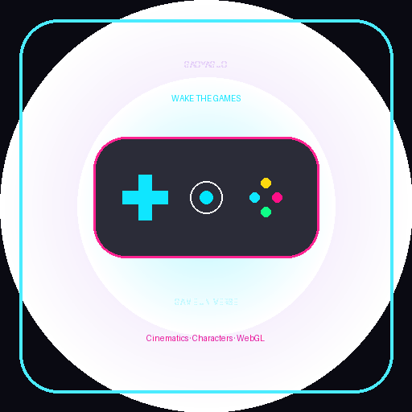
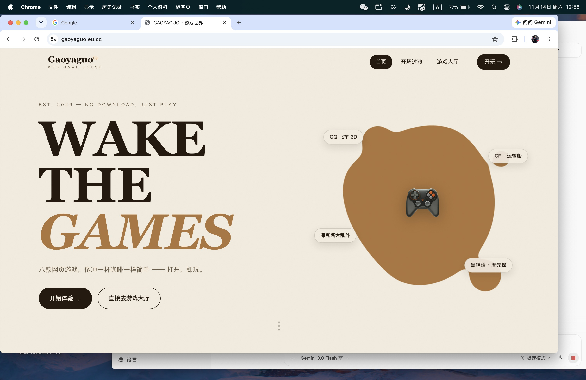
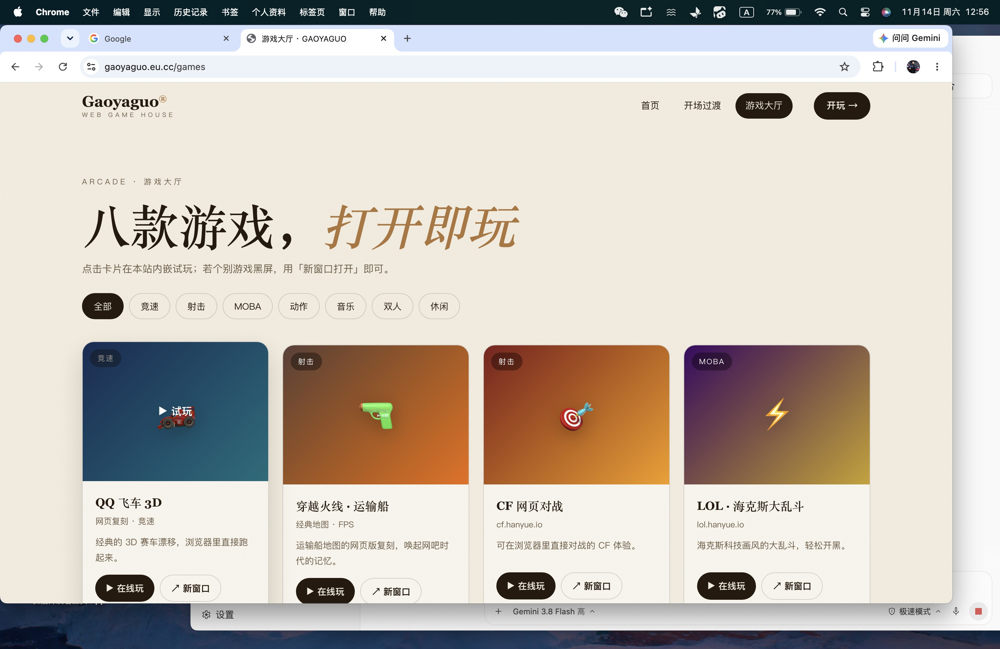
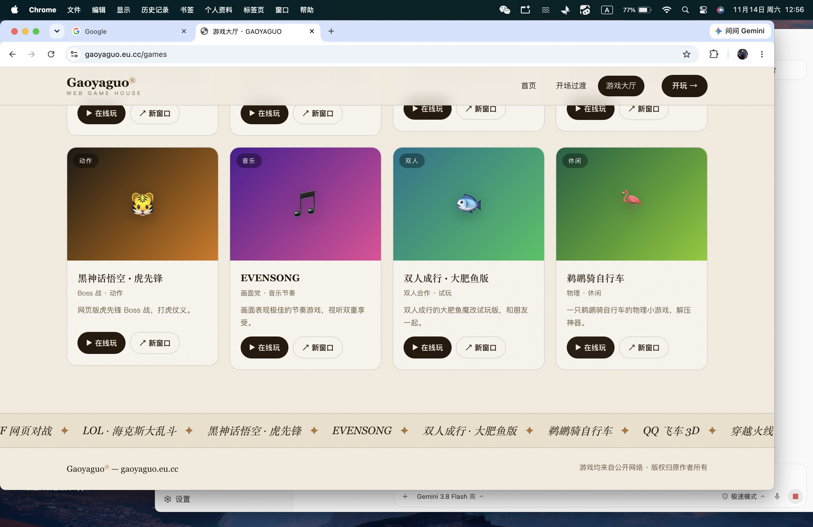
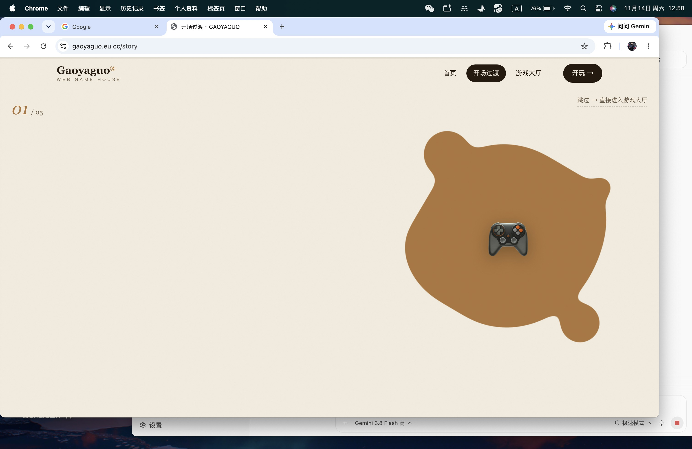

<div align="center">



# 🎮 Game Universe Studio (Gaoyaguo Edition)
### 全栈网页游戏展厅、电影级运镜与 IP 资产创作管线
**End-to-End Studio: From Loose Ideas to Playable Web Games, Locked Characters, 3D Cinematics & High-CTR Bento Cards**

[](https://287523023qq-hue.github.io/ai-cinematic-skills/)
[](https://github.com/alirezarezvani/claude-skills/releases/tag/v2.14.15)
[-2563eb?style=for-the-badge)](https://www.agensi.io/r/CREATOR980D20B?to=/bundles/ai-game-visual-asset-studio-suite&utm_source=github_game_studio)
[](https://www.agensi.io/r/CREATOR980D20B?to=/skills/game-universe-studio&utm_source=github_game_studio)

[演示展厅 (Live Showcase)](https://287523023qq-hue.github.io/ai-cinematic-skills/) · [4合1旗舰套餐 ($9.99省41%)](https://www.agensi.io/r/CREATOR980D20B?to=/bundles/ai-game-visual-asset-studio-suite&utm_source=github_game_studio) · [蓝V店铺主页](https://www.agensi.io/r/CREATOR980D20B?to=/creators/creator-980&utm_source=github_game_studio) · [技能规范 (SKILL.md)](./SKILL.md)

</div>

---

## 📸 展厅实景预览 (Visual Showcase)

| 🌌 1. 游戏宇宙传送门首屏 (Hero Portal) | 🕹️ 2. Bento Grid 3D 展厅 (WebGL Hall) |
| :---: | :---: |
|  |  |
| **QQ飞车 3D / CF 运输船 / 黑神话虎先锋** | **海克斯大乱斗 / 晚歌 / 双人成行 / 鹈鹕自行车** |
|  |  |
| **🎮 3. 街机试玩矩阵 (Arcade Matrix)** | **🎬 4. 沉浸式电影剧情转场 (/story Mode)** |

---

## 🌟 核心理念与四大融合支柱 (Core Pillars)

**Game Universe Studio** 是首个将“多模态 AI 生成”与“现代化 Web 前端工程”无缝咬合的生产级智能体技能。灵感来自已开源的线上游戏矩阵 **[gaoyaguo.eu.cc](https://gaoyaguo.eu.cc)**，将过往在角色生成、运镜推导、短视频视觉上沉淀的核心技术进行全面升维：

```
┌────────────────────────────────────────────────────────────────────────┐
│             GAME UNIVERSE STUDIO PRODUCTION PIPELINE                   │
├───────────────────┬───────────────────┬────────────────┬───────────────┤
│ Tier 1: 角色一致性 │ Tier 2: 运镜编译器 │ Tier 3: 视觉包装│ Tier 4: 展厅架构│
│ (CharacterStudio) │ (CinematicShot)   │ (VideoVisuals) │ (WebShowcase) │
├───────────────────┼───────────────────┼────────────────┼───────────────┤
│ • 4视角正交转角图 │ • 6维运镜物理合约 │ • Bento 便当盒 │ • WebGL/Canvas│
│ • 面部/装扮零漂移 │ • 3D 环绕展示镜头 │ • 极客高对比度 │ • 无依赖音频API│
│ • 2D/3D动作帧提取 │ • BOSS登场破雾运镜│ • 霓虹发光徽章 │ • /story 剧情 │
│ • 武器/装备标准化 │ • 极速赛道贴地飞掠│ • 爆款卡片排版 │ • 8大游戏模式 │
└───────────────────┴───────────────────┴────────────────┴───────────────┘
```

### 1. 🎨 角色资产一致性引擎 (Character Consistency)
- **拒绝 AI 变脸**：严格锁定角色五官骨骼、标志性发色、服装配饰与材质质感。
- **4 视角正交转角图 (Turnaround)**：单画布一次性生成正面、3/4 侧身、90° 纯侧面与背面，为 3D 建模或 2D 拆件提供标准工业图纸。
- **动作帧提取**：自动推导待机、冲刺、攻击判定、受击僵直等核心动作序列。

### 2. 🎬 电影级镜头运动编译器 (Cinematic Motion Compiler)
*技术源自官方 Claude Skills 成功合并之 [PR #1132](https://github.com/alirezarezvani/claude-skills/pull/1132) 核心算法：*
- **6 维物理运镜合约**：精确定义【起点 Anchor】、【机制 Mechanism】、【路径与加减速 Path/Velocity】、【主体锁定 Subject Lock】、【环境响应 Environment】与【落点 Ending Anchor】。
- 适用各类过场动画（Kling / Runway Gen-3 / Luma / Sora）与 3D WebGL 摄像机轨迹。

### 3. 🎯 高点击率 Bento 卡片与视觉包装 (High-CTR Visuals)
- **3 秒视觉焦点层级**：60% 破框角色剪影 + 30% 氛围背景 + 10% 霓虹技术徽章。
- **微交互与质感**：提供开箱即用的 Tailwind CSS 便当盒卡片代码、悬停浮动阴影与发光边缘。

### 4. 🕹️ 即玩型网页游戏展厅架构 (Instant-Play Showcase)
- **全栈游戏矩阵**：集成 8 大经典游戏原型，兼容 Three.js、Babylon.js、PixiJS 与 HTML5 Canvas。
- **无依赖音频合成器**：内置 Web Audio API 极简代码，0 外部音频文件依赖，实现街机按键音与环境音律动。
- **`/story` 沉浸式叙事流**：以电影级剧情串联世界观，在情绪顶点直接切入战斗试玩。

---

## 🕹️ 内置 8 大实战游戏蓝图 (Featured Game Blueprints)

在线体验全部 8 款游戏原型 👉 **[https://gaoyaguo.eu.cc](https://gaoyaguo.eu.cc)**

1. **QQ 飞车 3D** (`Three.js + Cannon.js`)：赛博朋克赛道极速漂移与物理引擎。
2. **穿越火线 · 运输船 WebGL** (`PointerLock API`)：第一人称射击集装箱竞技场。
3. **CF 网页对战 2D** (`HTML5 Canvas`)：经典像素复古对战射击。
4. **LOL · 海克斯大乱斗** (`Isometric Canvas`)：极地大乱斗奥术魔法粒子碰撞。
5. **黑神话悟空 · 虎先锋血池试炼** (`Babylon.js`)：硬核 BOSS 实时拼刀与闪避机制。
6. **EVENSONG 晚歌** (`CSS 3D Ambient`)：治愈系暮光探险独立小品。
7. **双人成行 · 大肥鱼版** (`Physics Cooperative`)：双人双摇杆趣味弹跳合作游戏。
8. **鹈鹕骑自行车** (`Matter.js`)：魔性物理布娃娃沙盒游戏。

---

## 🚀 快速接入 (Installation & Usage)

### 选项 A：在 Claude Code / Antigravity / Cursor 中一键引入
将本仓库克隆至您的智能体配置目录或工作空间中：

```bash
git clone https://github.com/287523023qq-hue/game-universe-studio.git
```

在对话中输入指令即可触发相应工作流：
- `game:character`：生成 4 视角角色一致性设定图纸与动作规范
- `game:cinematic`：编译 6 维电影级过场动画与 3D 摄像机提示词
- `game:card`：生成高转化率 Bento 便当盒卡片提示词与 Tailwind 前端代码
- `game:showcase`：导出完整可交互的响应式网页游戏展厅前端模板
- `game:full`：端到端全流程一键贯通

---

## 📦 目录结构 (Directory Structure)

```text
game-universe-studio/
├── SKILL.md                                 # 核心技能调度定义与触发规范
├── README.md                                # 项目中英说明主文档
├── LICENSE                                  # MIT 开源许可证
├── CREDITS.md                               # 致谢与开源生态组件
├── assets/                                  # 高清图标与真实展厅实测截图
│   ├── logo_512x512.png
│   ├── showcase_01_hero_portal.jpg
│   ├── showcase_02_games_bento_hall.jpg
│   ├── showcase_03_games_arcade_grid.jpg
│   └── showcase_04_story_cinematic_mode.jpg
├── references/                              # 5 大工业级实施参考手册
│   ├── game-showcase-architecture.md        # Bento Grid 展厅与音频合成架构
│   ├── cinematic-cutscene-compiler.md       # 6 维运镜合约编译规范 (PR #1132 演化)
│   ├── character-consistency-pipeline.md    # 角色一致性与转角图设定
│   ├── high-ctr-game-visuals.md             # 便当盒卡片高点击率配方
│   └── playable-demo-contracts.md           # 8 款内置游戏原型详细技术契约
└── examples/                                # 端到端实战工作流样例
    ├── workflow-boss-battle-showcase.md     # 案例：黑神话虎先锋 Boss 战资产全流程
    └── workflow-racing-track-showcase.md    # 案例：QQ飞车赛博赛道全流程
```

---

## 🌐 创作矩阵与生态联动 (Ecosystem & Cross-Links)

欢迎探索作者名下更多生产级开源项目与出海技能：
- 🎬 [cinematic-shot-prompting](https://github.com/287523023qq-hue/cinematic-shot-prompting) - 电影级镜头运动编译器 (已合并入 Claude Skills 官方库)
- 🎨 [character-creation-studio](https://github.com/287523023qq-hue/character-creation-studio) - 工业级 AI 原创角色一致性管线
- 🍌 [nano-banana-visuals](https://github.com/287523023qq-hue/nano-banana-visuals) - 短视频视觉资产与爆款封面生成器
- ✨ [lora-visual-mastery](https://github.com/287523023qq-hue/lora-visual-mastery) - LoRA 风格微调与材质一致性训练手册
- 🎮 在线游戏矩阵体验：[https://gaoyaguo.eu.cc](https://gaoyaguo.eu.cc)

---

## 📄 License

本项目采用 [MIT License](./LICENSE) 开源许可。
