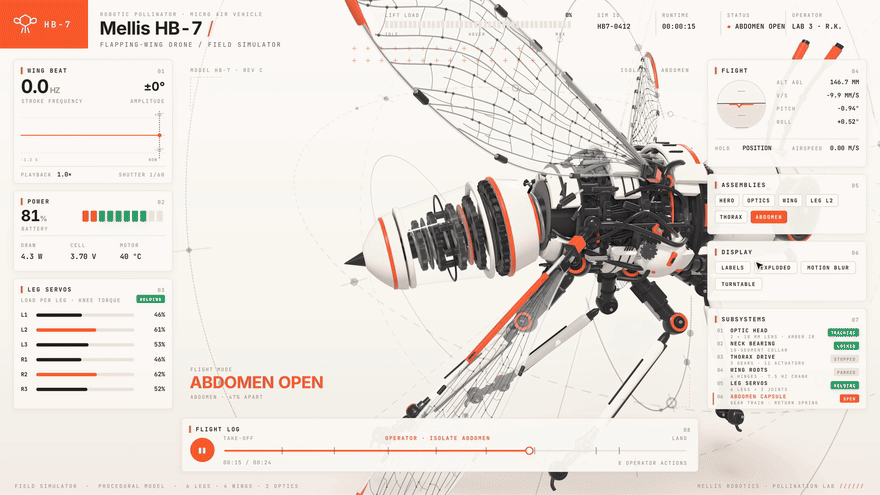
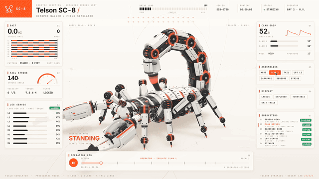

# teardown

A Claude Code skill that turns any machine into a 3D simulator you can take apart.

Ask how something works. Claude builds it as one offline HTML page: the machine runs in the middle, every panel around it reads the real numbers, a button opens the part doing the work, and when nobody touches it the page tours itself.



| Telson SC-8 robotic scorpion | Pelagos OC-8 robotic octopus |
|---|---|
|  |  |

## Install

```
npx skills add elvarofficial/teardown -g -a claude-code
```

Then, once, in the installed folder:

```
npm install && npx playwright install chromium
```

You need Node.js 20 or newer. For the video you also need `ffmpeg`, and for the sound Python 3.

## Use

Ask Claude Code in plain words:

> Build me a simulator of a 4-stroke motorcycle engine I can take apart.

> How does a mechanical watch keep time? Show me as a simulator.

> Make a teardown of a hydraulic excavator arm and record a 20-second video of it.

Or open one of the 3 examples first:

```
node sims/build.mjs v8-live          # teardown-out/dist/v8-live.html
node sims/build.mjs cessna-live
node sims/build.mjs strandbeest-live
```

## What is inside

| | |
|---|---|
| `SKILL.md` | What Claude reads: how a machine is built, the rules that make it look right, the review loop. |
| `sims/kit/` | Runtime, stage, shader warm-up. |
| `sims/v8-*`, `sims/cessna-*`, `sims/strandbeest-*` | 3 complete machines. `-shared` is the machine, `-live` the page you drive, `-film` the recorded tour. |
| `sims/build.mjs` | Bundles a machine into one HTML file, three.js and fonts inlined. |
| `sims/capture.mjs` | Renders the film frame by frame to a 60 fps mp4, or to review sheets of stills. |
| `sfx/`, `run_sfx.py` | Procedural sound on the film's timeline, mastered to −14 LUFS. |

## Credits

Built on [whaleyxbt/claude-motion](https://github.com/whaleyxbt/claude-motion) (MIT): the runtime, frame capture, sound engine and review rules come from there. Recorded samples are CC0 from Freesound, prepared by [Barty-Bart/motion-graphics](https://github.com/Barty-Bart/motion-graphics); sources in `sfx/samples/SOURCES.md`.

MIT licence.
