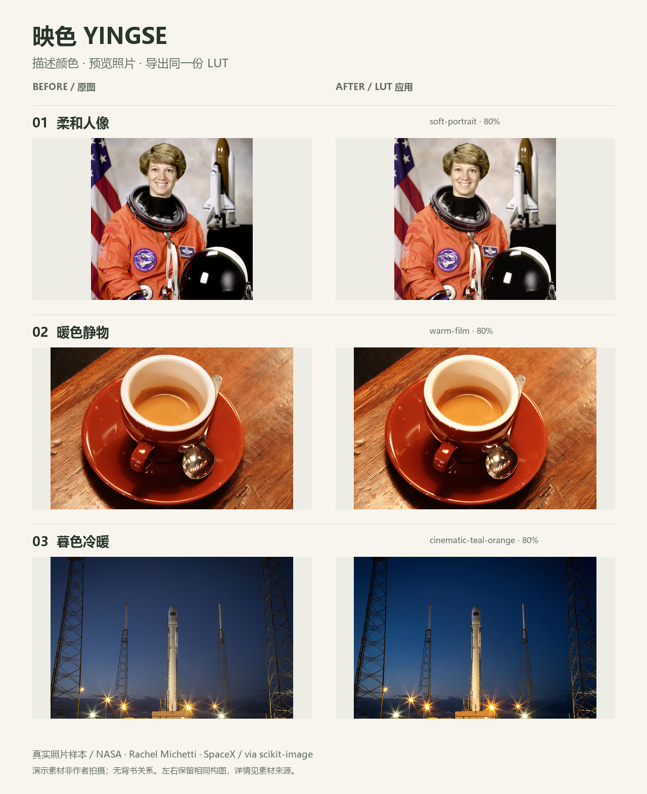

# 映色 Yingse · 一句话生成 LUT

**描述想要的颜色，用自己的照片看效果，再导出可复用的 `.cube`。**

Create a photo color grade from a style description. Preview the exported LUT, keep the recipe, and reuse the look.



上图为三张开放摄影样本的真实 LUT 应用结果，左原图、右效果。样本来自 NASA、Rachel Michetti 和 SpaceX，经 scikit-image 分发；不是作者拍摄、用户案例或机构背书。[素材来源](examples/SOURCES.md)

[安装](#安装) · [第一次试用](#第一次试用) · [下载演示包](https://github.com/kaiyihe699-max/codex-skills/releases/download/generate-lut-v5.0.3/Yingse-v5.0.3-demo.zip) · [正式版本](https://github.com/kaiyihe699-max/codex-skills/releases/tag/generate-lut-v5.0.3) · [English](#english) · [反馈](https://github.com/kaiyihe699-max/codex-skills/issues/new?template=yingse-feedback.yml)

## 适合做什么

- **人像更柔和**：略抬黑位、克制饱和度，让暖色保持适度。
- **旅行与日常照片统一风格**：保存一份配方，用在其他曝光、白平衡已基本正常的照片上。
- **街景或暮色探索冷暖关系**：比较偏暖、偏冷或青橙方向，然后导出选中的 LUT。

输出包括最终 `.cube`、左右对比图、效果图、完整配方和校验结果。默认 33³；**预览直接应用同一个导出 LUT，强度只写入一次。** 不需要额外 AI API key；自然语言由你的 Agent 转成显式调色参数，照片处理脚本在本地运行。

## 安装

在终端运行，然后选择你的 Agent：

```bash
npx skills add kaiyihe699-max/codex-skills --skill generate-lut
```

这是项目内安装；需要跨项目使用时加 `-g`。Skills CLI 自身需要 Node.js，支持的版本以[官方说明](https://github.com/vercel-labs/skills#install-a-skill)为准。

也可以下载仓库，将完整 `generate-lut` 文件夹放入你的 Agent 支持的 Skill 目录。请保留 `scripts/`、`references/` 和 `examples/`，不要只复制 `SKILL.md`。

**处理照片需要 Python 3.10+ 和 Pillow。** 如果缺少 Pillow，请让 Agent 安装该 Skill 内 `requirements.txt` 的依赖。不同 Agent 是否能执行脚本取决于其运行环境；安装 Skill 本身不等于已经具备 Python。

## 第一次试用

安装后，在支持此 Skill 的 Agent 中发送：

> 使用 $generate-lut，用自带的人像样本生成柔和暖调。给我原图与效果对比，导出 LUT 和配方，先做一版。

有自己的照片时，上传一张普通 JPEG/PNG，再发送：

> 使用 $generate-lut，把这张照片调成暖高光、微青暗部，保持肤色克制。先给我一个结果，并导出预览使用的同一份 LUT。

继续调整时说具体一点，例如“暗部少一点青，其他不变”。保存的 `recipe.json` 可用于重建同一 LUT；换照片时仍需检查适用性。

### 不通过 Agent，也能试运行

下载仓库后进入 `generate-lut` 文件夹：

```bash
python -m pip install -r requirements.txt
python scripts/doctor.py
python scripts/run_demo.py --example portrait --output-dir delivery/first-look
```

Windows 未配置 `python` 命令时可用 `py -3` 替换。已有同名输出目录或 ZIP 会被拒绝；再次运行请换一个输出名称。

三组示例均可离线运行，不需要安装 scikit-image：

| 示例 | 运行参数 | 已生成结果 |
| --- | --- | --- |
| 人像 · 柔和暖调 | `--example portrait` | [对比图](examples/looks/portrait/preview-comparison.png) · [LUT](examples/looks/portrait/look.cube) · [配方](examples/looks/portrait/recipe.json) |
| 静物 · 暖色胶片方向 | `--example still-life` | [对比图](examples/looks/still-life/preview-comparison.png) · [LUT](examples/looks/still-life/look.cube) · [配方](examples/looks/still-life/recipe.json) |
| 暮色 · 青橙方向 | `--example twilight` | [对比图](examples/looks/twilight/preview-comparison.png) · [LUT](examples/looks/twilight/look.cube) · [配方](examples/looks/twilight/recipe.json) |

[下载三组演示素材与结果](https://github.com/kaiyihe699-max/codex-skills/releases/download/generate-lut-v5.0.3/Yingse-v5.0.3-demo.zip)。其中 `START-HERE.md` 说明如何对照、复现和使用配方。

## 用在自己的照片上

在 Skill 根目录运行：

```bash
python scripts/create_lut_package.py --look warm-film --strength 0.65 --input my-photo.jpg --output-dir delivery/my-look
```

预览左侧是经过方向与色彩配置处理的输入，右侧是应用最终 LUT 的结果。强度已写入 `.cube`，在目标软件中先按 100% 应用；更改强度后应重新导出并检查一致性。

## 用之前了解这几件事

- 默认入口处理普通 **8-bit sRGB 创意调色**；带 RGB ICC 的照片先转换至 sRGB，未标记照片按 sRGB 假定。
- RAW 应先显影，Log/HDR 需要单独确认技术转换；不自动识别并保证相机编码。
- LUT 不包含颗粒、光晕、局部蒙版或空间修饰，也不承诺精确还原参考片、某种胶片或某位摄影师。
- 剪辑软件的输入色彩空间、显示变换或额外调整可能改变结果。相机档案检查不能代替真机导入验证。
- 无照片时也可生成灰阶／色块测试图；这只验证处理流程，不代表真实照片的视觉效果。

需要技术转换、LUT 串联、批量处理或 Panasonic S9 档案检查时，参阅 [完整 Skill](SKILL.md) 与 [色彩工作流](references/v5-workflow.md)。

## 遇到问题，或想分享结果

[提交映色反馈](https://github.com/kaiyihe699-max/codex-skills/issues/new?template=yingse-feedback.yml)，写明卡在安装、生成还是使用 LUT，以及系统、Agent 和报错即可。成功使用后也欢迎说明场景；只有你愿意公开且有权分享的照片才需要上传。

安装数、下载数和 GitHub Star 都不能证明持续使用。本工具不会把照片或使用记录自动发送给作者；反馈是自愿的。

## English

**Yingse / generate-lut** turns a color-grading request into a deterministic `.cube` LUT, a before/after comparison and a reproducible JSON recipe. Try warm portrait looks, travel photo grading, cooler shadows or LUT strength variations. No additional AI API key is required; your existing agent interprets the description, while the image-processing scripts run locally.

Install with the command above, then ask your agent:

> Use $generate-lut on the bundled portrait sample. Make one soft warm look, show the before/after, and export the exact LUT used in the preview plus its recipe.

For a direct first run, use the three Python commands under “第一次试用”. Python 3.10+ and Pillow/LittleCMS are required for photo previews. The included samples and starter pack work without scikit-image or a network connection. See [credits](examples/SOURCES.md).

The default creative workflow is 8-bit sRGB, not RAW development or automatic Log/HDR conversion. Technical tools are separate and require explicit source/target assumptions. Preview/export consistency is checked for the same file; visual quality and target-editor/device behavior still require review.

## License

The original code and documentation in this `generate-lut` folder are licensed under the [MIT License](LICENSE). This grant applies to Yingse only, not to other skills in the repository. Third-party sample photographs retain their documented terms; see [sample credits](examples/SOURCES.md). No endorsement or rights in depicted brands or identities are granted.
