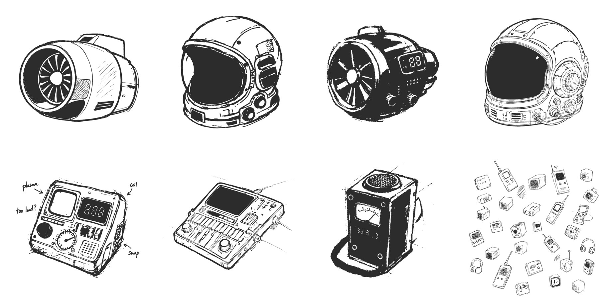
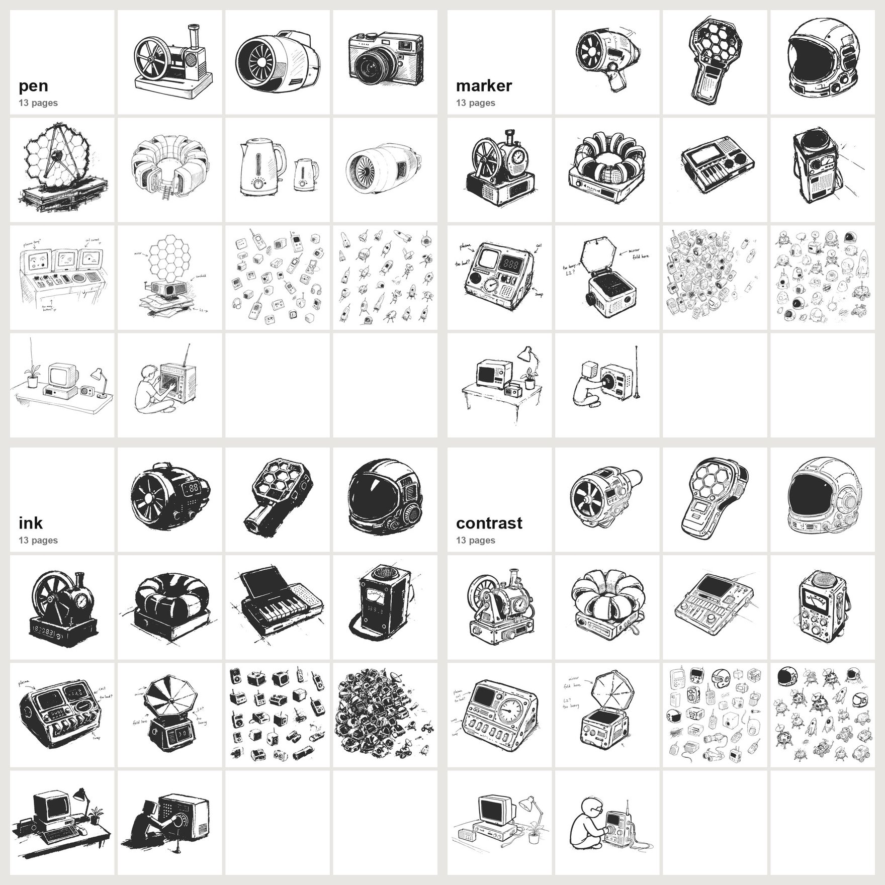
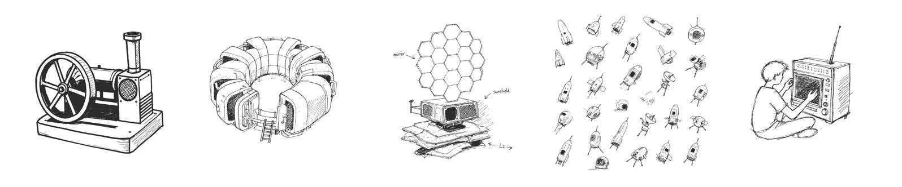
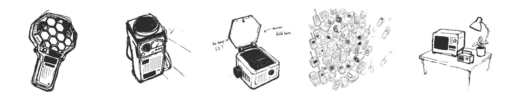
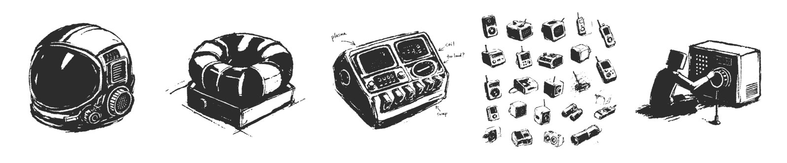
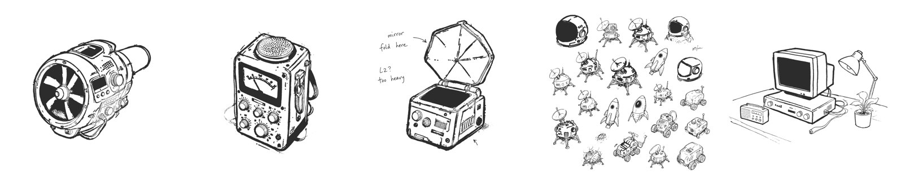

<h1 align="center">Sketchbook Style · 速写本画风</h1>

<p align="center"><b>把任何物件画成工业设计师速写本里的一页。</b><br>白纸黑墨，斜上方三分之二视角的简化硬件，排线，几块实黑，大片留白。四种变体，用开源出图模型，不需要 API 密钥。一个给 Claude Code 等编程 agent 用的 Agent Skill。</p>

<p align="center">
  <a href="https://code.claude.com/docs/en/skills"></a>
  <a href="https://agentskills.io"></a>
  <a href="#环境要求"></a>
  <a href="LICENSE"></a>
</p>

<p align="center"><a href="README.md">English</a> · <b>简体中文</b></p>

<p align="center"></p>
<p align="center"></p>

<p align="center"><sub>本页每一张画都是用这个 skill 画的：ComfyUI 上的 Qwen-Image 2.1，再经过自带的墨线后处理。提示词和种子在 <a href="references/"><code>references/</code></a>。</sub></p>

---

```text
把一台口袋合成器画成设计师速写本的一页，用马克笔变体，旋钮旁边写几句注释。
```

agent 会选好变体和页面类型，按 skill 里的模板写提示词，在你的 ComfyUI（或本机的 FLUX.2 klein）上出图，转成干净的单色墨线，再对照这种画风的指标量一遍：线宽、墨色覆盖率、墨里实心黑的占比。

## 快速开始

```sh
npx skills add Keith-CY/sketchbook-style -g -a claude-code
export COMFY_URL=http://127.0.0.1:8188   # 装好 Qwen-Image 2.1 的 ComfyUI
```

然后对 agent 说：

```text
画一页野外录音机的速写，用浓墨变体。
```

## 四种变体

| 变体 | 看起来 | 什么时候用 |
|---|---|---|
| **pen** · 细笔 | 规整的 0.5–0.8 毫米钢笔线，如实画真实物件，排线干净 | 要把一台真实机器讲清楚 |
| **marker** · 马克笔 | 一种粗马克笔线，几块带白色高光条的实黑，虚构的小装置，潦草的注释 | 氛围、章节开场、品牌画面、创意页 |
| **ink** · 浓墨 | 干笔马克笔，物件约一半实黑，细节在黑底上反白，边缘有飞白 | 海报、封面、高对比缩略图、小尺寸 |
| **contrast** · 粗细对比 | 线的粗细跟着疏密走：大形体粗轮廓加整片黑或白，细节用细线 | 一个主体，要远看清楚、近看有细节 |

**细笔 pen**



**马克笔 marker**



**浓墨 ink**



**粗细对比 contrast**



每一条从左到右是五种页面：**A** 粗线物件，**B** 结构草图，**C** 注释页，**D** 缩略图散布，**E** 小场景。全部 52 张样图在 [`examples/`](examples)。

## 你会得到

| | |
|---|---|
| **提示词模板** | 一段共用的画风核心，加上每种变体、每种页面的段落，都是在 Qwen-Image 2.1 上试出来的（试错的经验也写了：所有「不要……」都写在正向提示词里，CFG 保持 1）。 |
| **虚构或写实** | 默认把物件重新设计成复古未来感的小装置，用一套小符号来画：旋钮圆、点阵格栅、刻度、数字屏。说「写实」就保持认得出的原样。 |
| **墨线后处理** | `inkpost.py` 把任何出图转成纯单色墨线，再加上变体的样子：马克笔加粗、干笔飞白，或按疏密调线宽。 |
| **测量** | `measure.py` 量线宽、墨色覆盖率、实心黑占比和疏密线宽比，可以用数字检查，不只靠眼睛看。 |
| **核对清单** | 每一页必须有什么、不能有什么：没有灰、没有纸纹、没有地面和投影，注释只有字和箭头。 |

## 安装

这个仓库就是 skill 文件夹：根目录是 `SKILL.md`，旁边是 `scripts/`、`references/`、`examples/`。

| | 命令 | 装到 |
|---|---|---|
| **skills CLI**，给自己 | `npx skills add Keith-CY/sketchbook-style -g -a claude-code` | `~/.claude/skills/sketchbook-style` |
| **skills CLI**，单个项目 | `npx skills add Keith-CY/sketchbook-style` | `.claude/skills/sketchbook-style` |
| **git**，给自己 | `git clone https://github.com/Keith-CY/sketchbook-style.git ~/.claude/skills/sketchbook-style` | `~/.claude/skills/sketchbook-style` |

<details>
<summary><b>其他 agent</b></summary>

<br>

- **Codex、Cursor、Gemini CLI 等支持 Agent Skills 的 agent**：让它读 `SKILL.md`，其余都是普通文件。
- **Claude.ai 和 Claude 桌面版**：把文件夹压缩后在 设置 › 功能 › Skills 上传。出图仍需要一台能连上的 ComfyUI。

</details>

## 怎么用

说清楚画什么；在意的话，再说变体和页面类型：

```text
画一页托卡马克的速写，细笔变体，结构草图，角落再画一个小视图。
一页画二十个航天器的小点子，马克笔变体。
画一张海报风格的浓墨太空头盔。
同一台咖啡机四种变体各画一张，我来挑。
```

三个习惯能画得最好：

1. **说用途。** 「做海报」会选浓墨，「讲原理」会选细笔，「做章节开场」会选马克笔。
2. **点出关键部件。** 三到五个部件比一长段描述好，画风会把它们变成符号。
3. **注释要短。** 注释页给出确切的词，每条一到三个词，最多五条。

## 原理

- **[`SKILL.md`](SKILL.md)** 是 agent 读的：怎么选变体、提示词模板、后处理参数、指标和核对清单。
- **[`references/`](references)** 是每张样图背后的确切提示词和种子（`prompts-*.md`），以及各出图引擎的实测时间（`engines.md`）。
- **[`scripts/`](scripts)**：`comfygen.py`（带 Qwen-Image 2.1 工作流的 ComfyUI 客户端）、`localgen.sh`（经 mflux 跑 FLUX.2 klein / Z-Image 的本机备用）、`inkpost.py`（墨线后处理）、`measure.py`（测量）。

<details>
<summary><b>仓库结构</b></summary>

<br>

```text
sketchbook-style/
├── SKILL.md              agent 读的说明
├── scripts/              comfygen、localgen、inkpost、measure
├── references/           每种变体的提示词和种子、引擎说明
├── examples/             每种变体 13 张样图（pen、marker、ink、contrast）
└── .github/assets/       本 README 用的图
```

</details>

## 环境要求

| | 用于 | 说明 |
|---|---|---|
| **Claude Code**（或任何支持 Agent Skills 的 agent） | 选变体、写提示词 | |
| **ComfyUI**，装 [ComfyUI-GGUF](https://github.com/city96/ComfyUI-GGUF) 和 Qwen-Image 2.1（`qwen-image-2.1-Q6_K.gguf` 及其文本编码器和 VAE） | 效果最好 | Apple M3 Ultra 上每张 1024×1024 约 2 分钟；设置 `COMFY_URL` |
| **mflux**，配 FLUX.2 klein 4B 或 Z-Image Turbo | Apple Silicon 本机备用 | 把 `MODELS` 设为模型文件夹 |
| **Python 3**，装 Pillow 和 NumPy | `inkpost.py`、`measure.py` | |

可选：把 `GPU_LOCK` 设成一个路径，让几个任务轮流共用一块 GPU，一次一张。

## 局限

- **擅长画物件。** 机器、小装置、仪器、简单场景。人物会画得很简化，最好画小一点。
- **只有黑白。** 后处理会去掉所有灰色和颜色，这是有意的。
- **手写注释只有英文。** 现在的模型写其他文字不稳定。
- **缩略图散布页最难。** 出来往往比真实的速写本整齐；提示词在往乱的方向推，但有时还要多出几次。

## 不用 agent 手动用

```sh
python3 scripts/comfygen.py jobs.json out/          # jobs: [{"name": "...", "prompt": "...", "seed": 1}]
python3 scripts/inkpost.py out/helmet.png out/helmet-ink.png --marker
python3 scripts/measure.py out/helmet-ink.png
```

可以从 [`references/prompts-marker.md`](references/prompts-marker.md) 等文件里的提示词开始改。

## 致谢

出图模型：[Qwen-Image](https://github.com/QwenLM/Qwen-Image)（Apache 2.0）、[FLUX.2 klein](https://huggingface.co/black-forest-labs) 和 [Z-Image](https://github.com/Tongyi-MAI/Z-Image)，通过 [ComfyUI](https://github.com/comfyanonymous/ComfyUI) 和 [mflux](https://github.com/filipstrand/mflux) 运行。商用出图前请查看各模型自己的许可。

## 许可

[Apache License 2.0](LICENSE) © 2026 Keith-CY
