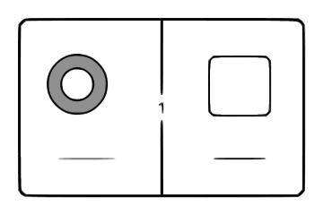

# Verified raster to SVG

An agent skill and local Python helper for converting dark line drawings into
SVG paths, recovering explicitly selected closed regions, and checking a PNG
render against the source. It works offline after dependencies are installed.



## Install the skill

From a local checkout of this public repository, install with the Skills CLI:

```bash
npx skills add .
```

Invoke it as `$raster-to-svg-verified`, or read [SKILL.md](SKILL.md). To install
manually, place the repository's contents in a directory named
`raster-to-svg-verified` under your agent's skill directory.

## Run the helper

Use Python 3.10+ and install Potrace with your system package manager. For
example, use `brew install potrace` on macOS or `apt install potrace` on Debian
and Ubuntu. The Python packages are isolated in a virtual environment:

```bash
python3 -m venv .venv
.venv/bin/python -m pip install -r requirements.txt
.venv/bin/python scripts/vectorize.py examples/source.png \
  --regions examples/regions.json --out output
```

On Windows, use `.venv\Scripts\python.exe` instead of `.venv/bin/python` and
install a native Potrace executable on `PATH`.

The output directory contains `drawing.svg`, `render.png`, `reference.png`,
`overlay.png`, `difference.png`, and `report.json`. The input is never modified.
Use `--overwrite` only when replacing these generated outputs is intended.

## Scope and evidence

The helper preserves original canvas coordinates, separates neutral ink from
optional named regions, and verifies that the generated SVG contains paths
without embedded raster images, live text, or external assets. It reports ink
overlap and rendering error; those metrics do not prove region identity.

Optional `--signal channel-max` removes bright flat fills under specific
assumptions. It can erase colored strokes. This is not a general photograph,
full-color, or alpha-faithful vectorizer. Read the [method and limits](references/method.md)
before changing the signal or reconstructing broken boundaries.

The reference is generated from simple abstract geometry. It contains no
private input, client material, conversation, or task-specific subject matter.
Its two editable compartments require one explicit gap repair, recorded in
[regions.json](examples/regions.json). The [example report](examples/report.json)
records the actual source and SVG checksums and measured result.

## Validate changes

Run the integration checks after modifying the helper:

```bash
.venv/bin/python -m unittest discover -s tests -v
```

The tests exercise observed behavior, including a real raster-to-SVG render,
hole preservation, border-leak rejection, fill-removal assumptions, structural
checks, and non-destructive output handling.

## Sources and license

See the [comparison with reviewed skills](references/method.md#relationship-to-existing-skills)
for attribution and the bounded contribution. This package's text, code, and
synthetic example are MIT licensed. Potrace is a separate dependency under its
own license; no Potrace binary or upstream skill code is distributed here.
