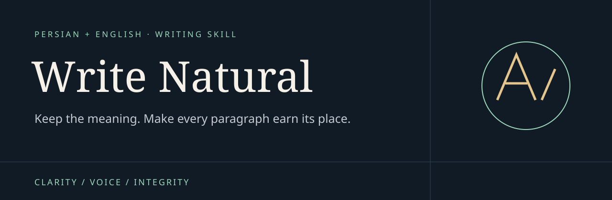

<p align="center"></p>

<p align="center"><strong>Useful writing. Faithful meaning. A voice that fits.</strong><br>دستورهای نویسندگی برای متن روشن، دقیق و متناسب با نویسنده</p>

<p align="center"><a href="README.fa.md">فارسی</a> · <a href="#quick-start">Quick start</a> · <a href="#how-it-works">Workflow</a> · <a href="docs/EXAMPLES.md">Examples</a> · <a href="references/source-analysis.md">Evidence</a> · <a href="CONTRIBUTING.md">Contribute</a></p>

<p align="center"></p>

# Write Natural

**Write Natural is a modular writing skill for AI assistants that support Markdown skills.** It helps draft, revise, translate and critique Persian and English writing while preserving facts, uncertainty, terminology and author voice. It combines editorial instructions, genre references, a source ledger and optional offline diagnostics.

Use it when a fluent draft still says little, an edit changes the meaning, a Persian passage reads like translated English, or every item in a batch uses the same template. It is intended for careful writing and revision; it is not an authorship detector or a guaranteed detector bypass.

## Contents

- [Quick start](#quick-start)
- [What it does](#what-it-does)
- [How it works](#how-it-works)
- [Choose a mode](#choose-a-mode)
- [Persian and English](#persian-and-english)
- [Optional offline tools](#optional-offline-tools)
- [Evidence and evaluation](#evidence-and-evaluation)
- [Package map](#package-map)
- [Limitations](#limitations)
- [Contributing and support](#contributing-and-support)

## Quick start

Clone or download this repository. Keep `SKILL.md`, `references/`, `scripts/`, `assets/` and `agents/` together. Register the directory as `write-natural` using your assistant's supported skill mechanism. Installation and ZIP import behavior differ by host; this repository does not claim a universal one-click installer.

```bash
git clone https://github.com/sinadwm1/write-natural.git
```

For a host that discovers skills under `~/.codex/skills`, place the complete folder at `~/.codex/skills/write-natural`, following that host's current installation instructions. If another version is installed, compare it first instead of overwriting it blindly. The writing instructions do not require Python; the optional diagnostics do.

Then ask:

```text
Use $write-natural to revise the passage below for a general audience.
Keep every number, citation, technical term and uncertainty qualifier.
Remove generic setup and repetition. Do not add facts or experience.
[Paste the passage and any supporting material.]
```

For an assistant without a skill loader, supply the core and the relevant linked references as context. That is manual use of the instructions, not a verified native installation. See [installation details](docs/INSTALLATION.md).

## What it does

| Need | Behavior |
|---|---|
| Anti-slop editing | Repair empty framing, inflated significance, vague authority, repeated summaries and interchangeable promotional language. |
| Factual fidelity | Protect quantities, citations, negation, scope, comparison groups and uncertainty before polishing. |
| Author voice | Match a supplied sample and the destination; avoid turning every author into neutral corporate prose. |
| Academic writing | Separate observations, inference and causation; preserve meaningful qualifications and reporting requirements. |
| Web and SEO | Answer the reader's actual question, organize useful information and reject ranking guarantees or arbitrary word-count folklore. |
| Copy and sales | Work from verified product facts, audience needs and a real offer; never invent testimonials or performance results. |
| Translation | Preserve claim relationships and terminology while adapting native idiom and register. |
| Creative and batch work | Preserve deliberate literary choices and vary real angles rather than swapping names into a template. |
| Detector-aware revision | Improve actual prose and interpret supplied results within scope, without promising undetectability. |

## How it works

1. **Set the brief.** Identify audience, purpose, language, destination, scope and available evidence.
2. **Protect meaning.** Lock names, numbers, quotations, citations, uncertainty and approved wording.
3. **Select references.** Load language and genre modules as needed rather than the full research archive.
4. **Draft or revise.** Build a specific answer with paragraphs that each contribute something.
5. **Review separately.** Check integrity, reasoning, structure, voice and language; inspect remaining formulaic phrasing in context.
6. **Check regressions and stop.** Compare the result with protected facts. Stop when remaining changes are preferences.

The skill does not impose blanket bans on passive voice, adverbs, headings, lists or long sentences. A technical term may need repetition. A formal Persian report need not become casual to sound natural.

## Choose a mode

| Mode | Ask for |
|---|---|
| `draft` | A finished text from a supplied brief and facts |
| `revise` | A substantive improvement with meaning preserved |
| `line-edit` | A bounded edit without rewriting unrelated material |
| `critique` | Exact passages, actual defects and specific repair directions |
| `outline` | A structure suited to the question and reader |
| `source-led` | Traceable claims from supplied or accessible evidence |
| `detector-aware` | Natural revision and honest interpretation of detector flags |
| `translate/adapt` | Faithful meaning with native language and register |
| `batch` | Multiple outputs with materially distinct content |

## Persian and English

Persian guidance covers register, native phrasing, هکسره, Persian ی/ک, normal نیم‌فاصله, punctuation, numerals and mixed-direction content. English guidance covers voice, clarity, consistency and meaningful grammatical choices. Code, URLs, citations and exact quotations are protected. Format-specific RTL rendering still requires appropriate document or presentation tooling.

```text
با $write-natural این بند را برای پایان‌نامه ویرایش کن.
عددها، اصطلاحات، استنادها و قیدهای احتمال حفظ شوند.
لحن علمی بماند و اطلاعات تازه اضافه نشود.
```

See the [Persian guide](README.fa.md) and [paired examples](docs/EXAMPLES.md).

## Optional offline tools

Python 3.9+; standard library only. Run from the repository directory:

```bash
python3 scripts/audit_text.py draft.txt --lang fa --profile academic --json
python3 scripts/audit_text.py draft.txt --lang en --profile web --json
python3 scripts/compare_revisions.py original.txt revised.txt --json
python3 -m unittest discover -s tests -p 'test_*.py' -v
```

`audit_text.py` locates a small set of stock phrases, selected Persian orthography issues and exact repetition. `compare_revisions.py` prompts review of changed numbers, units, ranges, protected spans and selected negation/uncertainty markers. Both are read-only and offline.

These tools do not prove factual accuracy, semantic equivalence, plagiarism status, writing quality or human authorship. Zero findings means only that these checks found nothing. Profiles record context; they do not silently apply different quality thresholds. See [CLI contracts and limitations](references/local-tools.md).

## Evidence and evaluation

The bundled ledger accounts for **112 source records and 276 analytical observations**. Findings are adopted, adapted, retained as context or rejected with reasons and integration targets. Access and reading scopes are explicit: not every full paper, visual figure or supplement was read.

The original assembly recorded **44 passing tool tests** and **eight reviewed writing cases**. These cover the exercised behavior, not universal writing improvement. The disclosed cases are regression material rather than a future blind benchmark. No external AI detector, conversion experiment, ranking experiment or human-reader trial was run.

- [Source analysis](references/source-analysis.md)
- [Machine-readable source reviews](references/evidence/source-reviews.json)
- [Coverage](references/evidence/coverage.json)
- [Validation scope](references/validation.md)
- [Original writing cases](references/evidence/behavior-checks.json)
- [Research synthesis archive](references/research-archive.md)

A source count is traceability, not proof of effectiveness. Source authors do not endorse this project. Full third-party papers and tools are not redistributed here.

## Package map

| Path | Purpose |
|---|---|
| `SKILL.md` | Core workflow and reference routing |
| `references/` | Language, genre, editorial, research and detector guidance |
| `references/evidence/` | Source records, review decisions and disclosed evaluation material |
| `scripts/` | Optional offline review diagnostics |
| `tests/` | Unit tests and real command-line tests |
| `assets/brief.json` | Structured writing brief |
| `assets/invariants.json` | Protected-content contract |
| `agents/openai.yaml` | Host-facing skill metadata |
| `docs/` | Public installation, examples and discovery notes |

Browse the [reference index](docs/REFERENCE-INDEX.md) for the complete module list.

## Limitations

Writing quality, naturalness and detector behavior are separate properties. The skill does not guarantee undetectability, factual correctness, publication acceptance, SEO rankings or sales lift. It does not reproduce algorithms requiring model weights, training, logits or watermark keys.

Do not add fake memories, deliberate errors, invisible substitutions or fabricated sources to make writing seem human. Keep required disclosures accurate. External services are not used by default; research that needs external facts still needs real evidence.

## Contributing and support

Useful reports include the language, genre, exact prompt, a nonconfidential input, actual output and the smallest concrete problem. Please avoid reporting only a detector score. See [contributing](CONTRIBUTING.md), [security](SECURITY.md) and the issue templates.

If this helps your writing, a star makes the project easier to find. Specific examples and fixes are even more useful. No paid stars, automated traffic or unsolicited promotion are part of this project.

## License

Original project material is available under the [MIT License](LICENSE). External works linked in the evidence ledger remain under their own terms. Attribution and provenance are described in [NOTICE](NOTICE).
