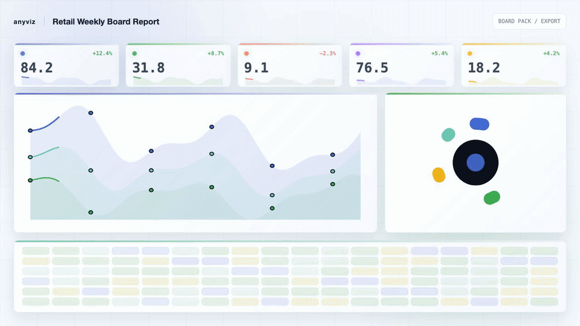

<p align="center">
  
</p>

<p align="center">
  <a href="https://www.npmjs.com/package/anyviz"></a>
  <a href="https://github.com/TseringYuu/anyviz"></a>
  <a href="LICENSE"></a>
  <a href="SKILL.md"></a>
  <a href="aesthetics/default.json"></a>
  <a href="adapters/web/d3.md"></a>
  
</p>

<p align="center">
  <a href="README.md">简体中文</a> · <b>English</b>
</p>

> **anyviz** is an AI-native data visualization specification and workflow library.
> It gives AI tools the judgment of a professional data designer: chart selection,
> aesthetic system, multi-stack rendering, and design consistency across every chart
> on a canvas.

---

## Why anyviz

LLMs can already write charting code. What they lack is *taste* and *consistency* —
the small decisions that separate a default-looking chart from a publication-grade one.
anyviz encodes those decisions as a reusable specification: which chart to choose,
what palette to apply, how to size type, where to place labels, and how to keep multiple
charts visually coherent.

- **Chart intelligence** — maps data shape and analytical intent (comparison, distribution,
  relationship, composition, trend, geographic, hierarchical, flow) to the right chart
  across **34 production-grade templates**.
- **A golden aesthetic** — grounded in Tufte's data-ink ratio and ColorBrewer / Viridis
  color science, with a perceptually balanced, colorblind-aware default theme.
- **Environment-aware rendering** — the same spec produces consistent output on the web
  (D3.js, ECharts, Mapbox, Three.js), in Python (Plotly, Matplotlib), and in R (ggplot2).
- **Consistency by default** — every unspecified property is inherited from the global
  spec, with a validator that enforces it across multi-chart layouts.
- **Accessibility built in** — contrast, redundant encoding, and alt-text guidance are
  part of the pipeline, not an afterthought.

---

The preview below highlights the range of outputs anyviz is designed to guide:
analytical reports, operational dashboards, geographic views, and monitoring
screens that combine multiple visualizations into one coherent canvas.

<p align="center">
  
</p>

## The Pipeline

anyviz processes every request through a five-stage workflow, so each step from raw data
to generated code meets a professional standard:

**Analyze → Aesthetics → Adapt → Consistency → Accessibility**

1. **Analyze** — map data shape and intent to one of 34 chart templates
2. **Aesthetics** — apply unified color and type scale (Tufte)
3. **Adapt** — detect the project stack and emit D3 / ECharts code
4. **Consistency** — sync entity colors, number formats, and spacing
5. **Accessibility** — contrast, colorblind safety, and alt text

---

## Quick Start

### With any AI assistant

Point your AI coding tool at this repository and describe what you want in natural
language. `SKILL.md` is the tool-agnostic workflow entry point; the guides, templates,
adapters, and aesthetic spec provide the supporting context.

Install for every detected agent on macOS or Linux:

```bash
curl -fsSL https://raw.githubusercontent.com/TseringYuu/anyviz/main/install.sh | sh
```

On Windows PowerShell:

```powershell
irm https://raw.githubusercontent.com/TseringYuu/anyviz/main/install.ps1 | iex
```

The installer uses only system shell tools—no Node.js or Python. The shared Agent Skills
directory covers Codex, Cursor, OpenCode, OpenClaw, Cline, Kimi Code CLI, Warp, Zed, and
other compatible tools. It also detects native skill roots for Claude Code, Hermes Agent,
Gemini CLI, GitHub Copilot, Windsurf, Goose, and more. Run the same command again to update.
An unmanaged skill with the same name is preserved as a timestamped backup before installation.

```text
Visualize this sales data for me
Show population by province on a map
Build a dashboard for our key business metrics
Make these charts dark-themed
```

### As a standalone aesthetic library

The spec is plain JSON, so any tool or script can consume it directly.

```bash
npm install anyviz
```

```js
const anyviz = require('anyviz');

const theme = anyviz.defaultTheme();
const academicTheme = anyviz.themes.academic();

console.log(anyviz.guides.academicPublication);
console.log(theme.color.categorical.palette);
console.log(academicTheme.publication.export.dpi_min);
```

```python
import json

# Load the authoritative anyviz aesthetic spec
with open('aesthetics/default.json', encoding='utf-8') as f:
    theme = json.load(f)

# Categorical palette
palette = theme['color']['categorical']['palette']
print(f"Categorical palette: {palette}")

# Typographic scale
h1 = theme['typography']['scale']['h1']
print(f"Title: {h1['size_px']}px / weight {h1['weight']}")
```

---

## Template Library (34)

| Category | Count | Templates |
| :--- | :---: | :--- |
| [`templates/charts/`](templates/charts) | 20 | bar, line, scatter, area, pie/donut, histogram, box plot, heatmap, radar, waterfall, density, waffle, dot, slope, small multiples, calendar heatmap, candlestick, hexbin, parallel coordinates, scatter matrix |
| [`templates/maps/`](templates/maps) | 3 | choropleth, bubble map, flow map |
| [`templates/graphs/`](templates/graphs) | 8 | sankey, chord, force-directed, treemap, sunburst, dendrogram, arc diagram, alluvial |
| [`templates/3d/`](templates/3d) | 3 | 3D globe, 3D scatter, 3D surface |

Every template follows the unified five-section structure defined in
[`templates/TEMPLATE-SPEC.md`](templates/TEMPLATE-SPEC.md): *use cases, data format,
aesthetic parameters, design points, and variants.*

---

## Core Principles

**1. Aesthetics first.** Maximize the data-ink ratio and eliminate chartjunk. Prefer direct
labeling over legends, and small multiples over animation, so the data itself is the focus.

**2. Consistency over customization.** Any property you don't specify is inherited from the
global spec. Even when a caller overrides a single color, type, spacing, and gridlines stay
strictly uniform.

**3. Environment-aware adaptation.** anyviz detects the runtime and dependencies and produces
visually consistent output across web, Python, and R — without the caller managing the stack.

**4. Explainable & modifiable.** Every output ships with the reasoning behind its chart choice
and aesthetic decisions. Nothing is a black box; any parameter can be understood and adjusted.

---

## Default Palette

The default `modern` theme is inspired by Observable Plot's contemporary design language —
bright, restrained, and colorblind-aware.

| | Hex | Role |
| :---: | :--- | :--- |
| 🔵 | `#4269d0` | Primary series — stability, trust |
| 🟢 | `#3ca951` | Secondary — growth, positive, on-target |
| 🔴 | `#ff725c` | Contrast — warning, negative, loss |
| 🟣 | `#a463f2` | Auxiliary — highlight, special contrast |
| 🟡 | `#efb118` | Auxiliary — attention, caution |
| 🩵 | `#6cc5b0` | Auxiliary — teal, neutral contrast |
| ⚪ | `#9696a0` | Neutral gray — reference lines, "other" |
| 🟠 | `#f5a623` | Orange — high-contrast highlight |
| 🩷 | `#ca5bb8` | Magenta — special category |
| 🌸 | `#ff8ab7` | Pink — auxiliary category |

Full palette rationale and colorblind notes: [`guides/color-guide.md`](guides/color-guide.md)
and [`guides/accessibility.md`](guides/accessibility.md).

---

## Stack Adaptation

anyviz parses the calling context and dependencies to choose the right engine automatically:

| Environment | Default | When | Strengths |
| :--- | :--- | :--- | :--- |
| **Web** | **D3.js** | Default — zero dependencies, full custom control | Pixel-level control, no deps |
| **Web** | **ECharts** | `echarts` already in the project, or batteries-included charts | High performance, rich interaction |
| **Web** | **Mapbox** | Geospatial data, high-fidelity maps | Pro-grade map rendering at scale |
| **Web** | **Three.js** | 3D space, surfaces, immersive scenes | Native 3D, hardware accelerated |
| **Python** | **Plotly** | Jupyter, interactive analysis, dashboards | Interactive, exports to HTML |
| **Python** | **Matplotlib** | Papers, print, static high-DPI output | Print-friendly, academic norms |
| **R** | **ggplot2** | Statistical analysis in the R ecosystem | Declarative grammar of graphics |

---

## Natural-Language Customization

anyviz maps plain-language instructions onto aesthetic parameters while preserving consistency:

| Dimension | You say | Maps to | Effect |
| :--- | :--- | :--- | :--- |
| **Theme** | "dark mode" | page `#1A1A1A`, text `#E8E8E8`, palette +15% lightness | Immersive dark canvas, high contrast |
| **Style** | "academic / for a paper" | serif type, hide Y gridlines, keep outer frame | Restrained, publication-ready |
| **Style** | "research report / thesis charts" | apply academic publication rules, external captions and source notes, no duplicated in-chart sources | Suitable for bound documents, formal research reports, and review materials |
| **Style** | "minimal" | drop gridlines and borders, keep core axes | Maximum data-ink ratio |
| **Color** | "warm tones" | restrict hue to 0°–60° | Energetic, warm feel |
| **Color** | "cool tones" | restrict hue to 180°–270° | Calm, technical feel |
| **Type** | "bigger text" | scale all levels (H1–H6) ×1.15 | Readable on large displays |
| **Layout** | "center the chart / title" | anchor titles to the full canvas and verify visual centering after export | Prevents apparent offsets in Word, papers, and reports |
| **Layout** | "move the legend farther away" | use legend safe bands and minimum clearance from titles, axes, and labels | Keeps legends from crowding chart elements |
| **Layout** | "for mobile" | apply mobile breakpoint, 1:1 aspect | Fits narrow screens, no label overlap |
| **Elements** | "show data labels" | enable data labels (9px, `#888888`) | Read exact values without hover |

Full mapping: [`guides/customization-guide.md`](guides/customization-guide.md).

---

## Repository Structure

```text
anyviz/
├── SKILL.md                  # AI workflow entry point (pipeline + core rules)
├── README.md                 # Chinese main document
├── README.zh-CN.md           # Chinese landing page pointer
├── aesthetics/               # Authoritative aesthetic spec
│   ├── default.json          # Default theme (color, type, spacing, stroke, responsive)
│   ├── color.md              # Color rules & colorblind-safe palettes
│   ├── typography.md         # Type rules & multilingual fonts
│   ├── layout.md             # Layout rules & data-ink standards
│   └── themes/               # modern · analytics · dashboard · academic
├── guides/                   # Decision, customization, and publication guides
│   ├── academic-publication.md# Charts for papers, research reports, and bound documents
│   ├── chart-selection.md    # Chart decision tree (data + intent → chart)
│   ├── color-guide.md        # Color principles & semantic conventions
│   ├── consistency-rules.md  # Multi-chart consistency rules
│   ├── customization-guide.md# Natural language → aesthetic parameters
│   ├── legend-layout.md      # Legend layout (bounds, collision, grid, centering)
│   └── accessibility.md      # Contrast, colorblind safety, redundant encoding, alt text
├── templates/                # 34 chart templates
│   ├── TEMPLATE-SPEC.md       # Unified template specification
│   ├── charts/               # 20 statistical charts
│   ├── maps/                 # 3 geographic charts
│   ├── graphs/               # 8 relational & hierarchical charts
│   └── 3d/                   # 3 three-dimensional charts
├── adapters/                 # Stack-specific adapters (web / python / r)
├── assets/                   # README banner, wordmark, and showcase media
├── examples/                 # Runnable examples + per-example READMEs
└── scripts/
    ├── theme_validator.py    # Automated theme-consistency validator
    └── make_*.py             # Reproducible brand-asset helpers
```

---

## Examples

Each example in [`examples/`](examples) is a complete, runnable **industry big-screen
dashboard** — not a single chart, but a full canvas of coordinated visualizations in the
anyviz dark-screen aesthetic. Together they show how the same specification can support
financial monitoring, retail operations, energy IoT, and geospatial command-center use cases.

- [`finance-trading`](examples/finance-trading) — real-time market monitoring: candlestick + MAs, intraday indices, capital flow, sector heatmap
- [`ecommerce-retail`](examples/ecommerce-retail) — retail operations: GMV trend, category mix, regional sales map, conversion funnel
- [`iot-energy`](examples/iot-energy) — smart-energy IoT: live power curves, energy mix, device gauges, topology graph, alarms
- [`city-geo`](examples/city-geo) — urban big-data: map flight-lines + ripples, city rankings, footfall trends, 24h heatmap

All four are single-file `index.html` (ECharts 5.5.1), built for 1920×1080 and responsive.

---

## Contributing

Contributions are welcome — new templates, adapters, and guide improvements especially.
See [CONTRIBUTING.md](CONTRIBUTING.md) for the template structure, validation steps, and PR
process, and [CODE_OF_CONDUCT.md](CODE_OF_CONDUCT.md) for community expectations.

```bash
# Validate a theme config locally
python3 scripts/theme_validator.py -c examples/test_config_valid.json
```

---

## Community

- [LINUX DO](https://linux.do) — A community for discussion, sharing, and collaboration

---

## License

[MIT](LICENSE)

---

## References

anyviz is grounded in the classics of information visualization:

- **Edward Tufte** — *The Visual Display of Quantitative Information* (data-ink ratio, chartjunk)
- **Nathan Yau** — *Data Points: Visualization That Means Something* (perceptual design, data storytelling)
- **ColorBrewer 2.0** — *Color Advice for Cartography* (perceptually balanced, colorblind-safe palettes)
- **Viridis** — *Perceptually Uniform Colormaps* (high perceptual resolution, print- and colorblind-safe)
