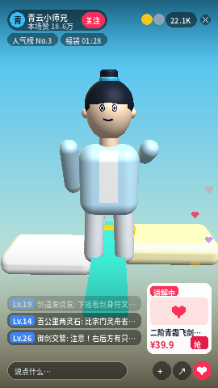
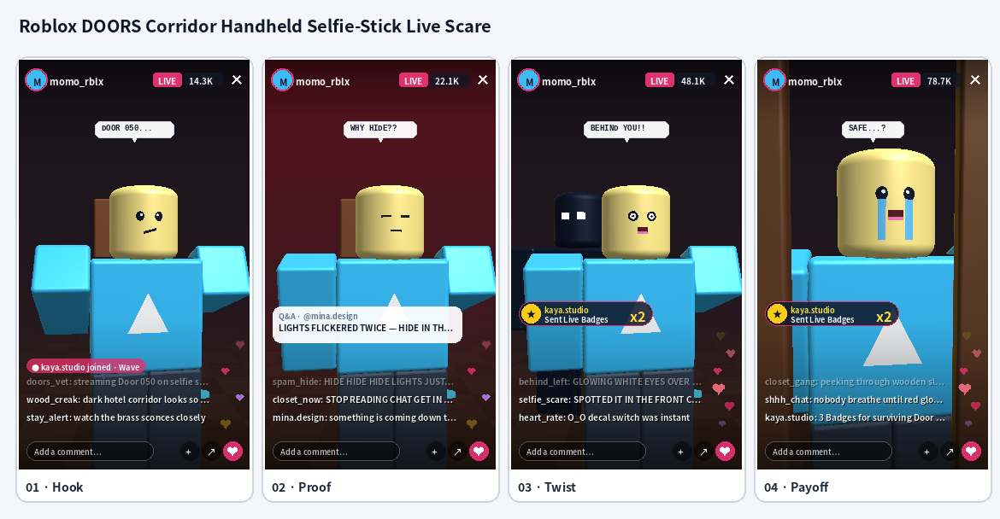

<div align="center">

# Livestream Style Video Skill

An Agent Skill (`SKILL.md` + reference playbooks + offline CLI tools) for Claude Code, Cursor, GitHub Copilot, and Codex to map any visual style or storyline into 9:16 livestream-perspective shorts, compile clean-plate video prompts, overlay mainstream room HUDs, and preview cuts locally.

[](SKILL.md)
[](#skill-workflow-and-quick-start)
[](LICENSE)

**[Video examples](#video-examples)** · [Scene boards & live HUDs](#scene-boards-and-shot-pacing) · [Skill workflow & quick start](#skill-workflow-and-quick-start) · [Skill guide](SKILL.md)

**English** · [简体中文](README.zh-CN.md) · [繁體中文](docs/i18n/README.zh-TW.md) · [日本語](docs/i18n/README.ja.md) · [한국어](docs/i18n/README.ko.md) · [Español](docs/i18n/README.es.md) · [Français](docs/i18n/README.fr.md) · [Deutsch](docs/i18n/README.de.md) · [Português](docs/i18n/README.pt-BR.md) · [Русский](docs/i18n/README.ru.md)

</div>

<a name="examples-and-local-3d-previews"></a>

## Video examples

When invoked in an AI coding agent, this skill translates any visual style or story plot into a 15-second, four-shot vertical (`9:16`) livestream package across eight built-in formats (five realistic & cross-genre AI video streams plus three Roblox blocky streams). The **MP4s** and GIFs below are offline 3D + Post-HUD animatics rendered by `scripts/render_preview.mjs` so you can verify physical camera mounts, `0°/15°` chat eye-lines, safe zones, and room overlays before spending credits in an external video model.

<p align="center">
  <a href="examples/irl-night-market-selfie/assets/irl_night_market_selfie.mp4"></a>
  <a href="examples/desk-unboxing-autofocus/assets/desk_unboxing_autofocus.mp4"></a>
  <a href="examples/midnight-corridor-fpv-live/assets/midnight_corridor_fpv_live.mp4"></a>
  <a href="examples/late-night-study-webcam/assets/late_night_study_webcam.mp4"></a>
  <br />
  <a href="examples/wuxia-sword-flight-live/assets/wuxia_sword_flight_live.mp4"></a>
  <a href="examples/roblox-obby-rage-pip/assets/roblox_obby_rage_pip.mp4"></a>
  <a href="examples/roblox-doors-irl-selfie/assets/roblox_doors_irl_selfie.mp4"></a>
  <a href="examples/roblox-pet-hatch-pk/assets/roblox_pet_hatch_pk.mp4"></a>
</p>

## Scene boards and shot pacing

Video diffusion models lose physical camera truth when a single 4–5 second clip chains multiple actions or switches mounts mid-shot. Each livestream short splits any plot into four single-action live beats (`0–3.5s` cold-open claim, `3.5–7.5s` close-up lens proof, `7.5–11.5s` unscripted live twist, and `11.5–15s` chat-flood reaction):

| Shot 01 · Hook (`0–3.5s`) | Shot 02 · Proof (`3.5–7.5s`) | Shot 03 · Twist (`7.5–11.5s`) | Shot 04 · Payoff (`11.5–15s`) |
| :---: | :---: | :---: | :---: |
|  |  |  |  |

Four-shot contact sheets across six camera rigs and visual styles (general photorealistic IRL, genre plot adaptation, and Roblox blocky rigs):

| 01 · Night-Market Selfie (`Kling` · `18mm` Gimbal & Douyin HUD) | 02 · Desk Autofocus Unboxing (`Seedance` · `[AF-C]` & Kuaishou HUD) |
| :---: | :---: |
| <a href="examples/irl-night-market-selfie/"></a> | <a href="examples/desk-unboxing-autofocus/"></a> |
| **04 · Late-Night Study Webcam (`Wan` · `24mm` Monitor Cam & X HUD)** | **06 · Roblox Sky-Obby + PiP (`Hailuo` · Dual-Track & TikTok HUD)** |
| <a href="examples/late-night-study-webcam/"></a> | <a href="examples/roblox-obby-rage-pip/"></a> |
| **07 · Roblox DOORS Corridor Selfie (`Sora` · `18mm` Stick & IG HUD)** | **08 · Roblox 50/50 Egg PK (`Kling` · Dual Split & Kuaishou HUD)** |
| <a href="examples/roblox-doors-irl-selfie/"></a> | <a href="examples/roblox-pet-hatch-pk/"></a> |

Five reconstructed mainstream livestream HUD presets (`douyin`, `kuaishou`, `instagram`, `x`, `tiktok`)—covering safe-zone headers, join ribbons, 2-slot gift combos, live shopping cards, frosted Q&A cards, `1v1 PK` tug-of-war bars, and Periscope 6-color heart fountains—are composited after clean-plate generation or tested live in [`studio/index.html`](studio/index.html) ([REA ledger](references/platform-ui-rea-ledger.md)):

<p align="center">
  
</p>

## Skill workflow and quick start

<p align="center">
  
</p>

### Install as an Agent Skill

Clone this skill into your agent host's skills directory. Once installed, the agent reads [`SKILL.md`](SKILL.md), loads the relevant camera/HUD guides from [`references/`](references/), and runs the Node.js scripts automatically when you ask for a livestream-perspective short. This path is for Codex; use `~/.copilot/skills/livestream-style-video` for GitHub Copilot, or your configured skills folder in Claude Code and Cursor.

```bash
git clone https://github.com/yuzhang-zhong/livestream-style-video.git ~/.codex/skills/livestream-style-video
```

Trigger the `livestream-style-video` skill in your agent chat:

```text
Use $livestream-style-video to adapt "a medieval knight unboxing an enchanted sword at a dragon cave entrance when the dragon wakes up"
into a 15-second 9:16 handheld selfie livestream with Douyin live shopping and gift combo overlays.
Give me the camera rig lock, a 4-shot clean-plate storyboard, and Kling / Sora I2V prompts.
```

### Run the skill's CLI tools directly

Every helper script bundled inside the skill also runs standalone from the repository root on Node.js 18+ using only the standard library (no `npm install` or API keys; `python3` Pillow + `ffmpeg` enable anti-aliased CJK HUD compositing and H.264 MP4 encoding).

```bash
node scripts/render_preview.mjs --spec templates/custom_livestream_spec.json --out-dir out/ramen-live --platform douyin --force
node scripts/shot_compiler.mjs --plot "Ramen stall chef reading live chat at 2am when the broth pot boils over" --platform douyin --engine kling --lang en
node scripts/drift_check.mjs --pack templates/custom_livestream_spec.json --engine kling --lang en
```

## Skill scripts, anti-drift checks, and references

Prompting `"a livestream video with comments"` directly in video diffusion models triggers detached third-person crane shots, burned-in alien gibberish UI text, melted single-pass T2V corner facecams, or human fingers on blocky Roblox streamers. `drift_check.mjs` flags these failure modes across 8 gates before generation so external models render clean raw camera plates while `render_preview.mjs` and [`studio/index.html`](studio/index.html) composite crisp HUDs:

<p align="center">
  
</p>

| Skill component | Output |
| --- | --- |
| [`SKILL.md`](SKILL.md) | Main Agent Skill entry point defining the 6 production modes (`Rig-Spec`, `Plot-to-Live`, `Prompt-Compile`, `Platform-HUD`, `Rescue`, `Render`) and 8 livestream invariants. |
| [`shot_compiler.mjs`](scripts/shot_compiler.mjs) | Compiles `--plot "<any story>"`, `--spec <episode.json>`, or 8 built-in templates into non-repeating 15s / 30s / 45s 9:16 clean-plate prompts + HUD timelines (`local3d`, Kling, Seedance, Hailuo, Wan, Sora, Veo, Runway). |
| [`rig_spec.mjs`](scripts/rig_spec.mjs) | Locks 8 physical camera rigs × 6 orthogonal visual styles (`realistic-irl`, `roblox-blocky`, `anime-vtuber`, `stylized-3d`, `voxel-sandbox`, `cinematic-genre-adapt`) and a [3-state setup sheet](assets/showcase/rig_setup_sheet.en.png) prompt. |
| [`hud_presets.mjs`](scripts/hud_presets.mjs) | `1080×1920` safe zones, comment styles, 2-slot gift combos, shopping/Q&A popups, PK bars, and heart palettes for `douyin`, `kuaishou`, `instagram`, `x`, `tiktok`, and `clean`. |
| [`drift_check.mjs`](scripts/drift_check.mjs) | 8-gate Unicode-safe linter (`--prompt` or `--pack`) catching cinema crane drift, gibberish UI text, passive eye-lines, T2V PiP melt, Roblox five-finger/Lego leaks, and action overload. |
| [`render_preview.mjs`](scripts/render_preview.mjs) | Direct local 3D + Post-HUD `.mp4` / `.gif` / contact-sheet renderer (`--spec <episode.json> --out-dir <dir>`) with dual-track PiP, 50/50 PK split, and synthesized WAV live room audio. |
| [`studio/index.html`](studio/index.html) | Browser / OBS interactive HUD studio with 3 live `<canvas>` camera previews, MP4 plate loader, popup triggers, and `#00FF00` chroma-key export ([preview](assets/showcase/interactive_hud_studio.png)). |

[Camera rigs and optics](references/camera-rigs-and-optics.md) · [Style adapters matrix](references/style-adapters-matrix.md) · [Plot-to-livestream beats](references/plot-to-livestream-beats.md) · [Platform UI REA ledger](references/platform-ui-rea-ledger.md) · [Model prompt playbook](references/model-prompt-playbook.md) · [Drift fixes](references/rescue-and-anti-drift.md) · [8 story templates](references/viral-livestream-archetypes.md)

## Languages

Agent Skill replies and CLI `--lang` output support `en`, `zh`, `zh-tw`, `ja`, `ko`, `es`, `fr`, `de`, `pt`, and `ru`.

**English** · [简体中文](README.zh-CN.md) · [繁體中文](docs/i18n/README.zh-TW.md) · [日本語](docs/i18n/README.ja.md) · [한국어](docs/i18n/README.ko.md) · [Español](docs/i18n/README.es.md) · [Français](docs/i18n/README.fr.md) · [Deutsch](docs/i18n/README.de.md) · [Português](docs/i18n/README.pt-BR.md) · [Русский](docs/i18n/README.ru.md)

[MIT License](LICENSE). Independent open-source Agent Skill; uses clean-room geometric UI reconstructions and is not affiliated with or endorsed by ByteDance, Kuaishou, Meta, X Corp., or Roblox Corporation.
