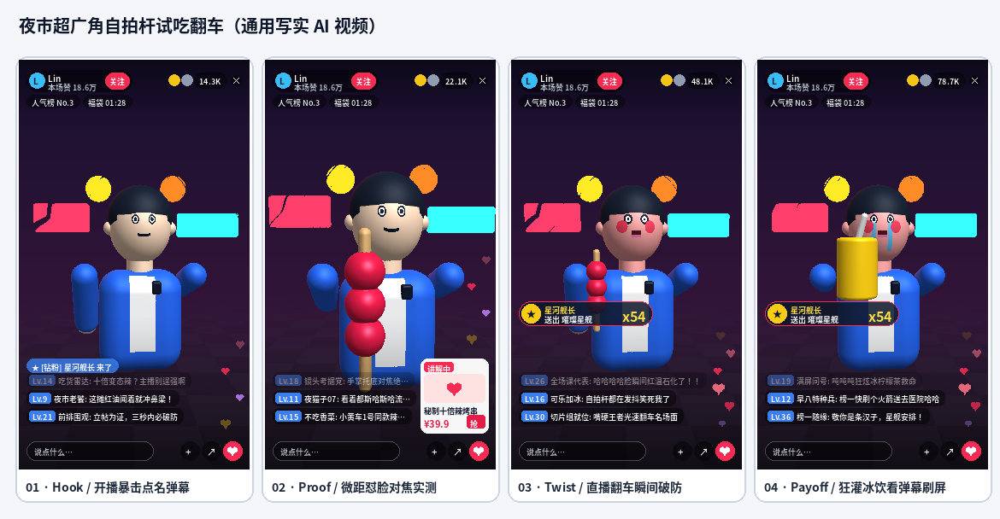
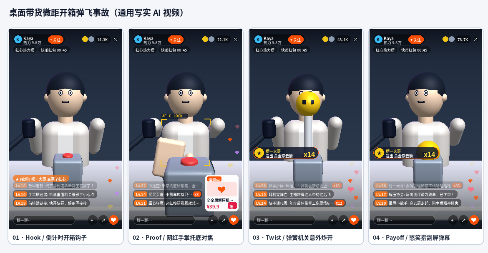
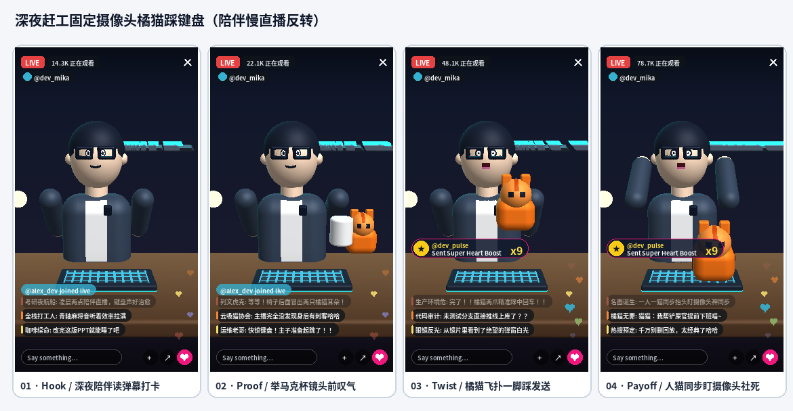
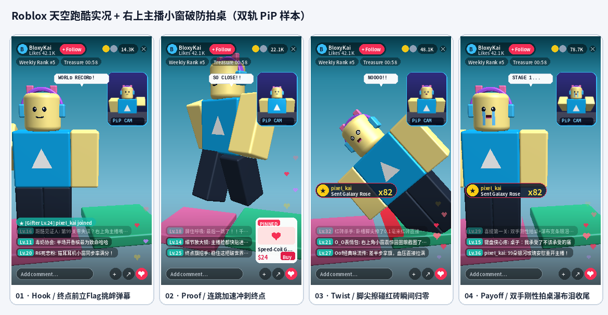
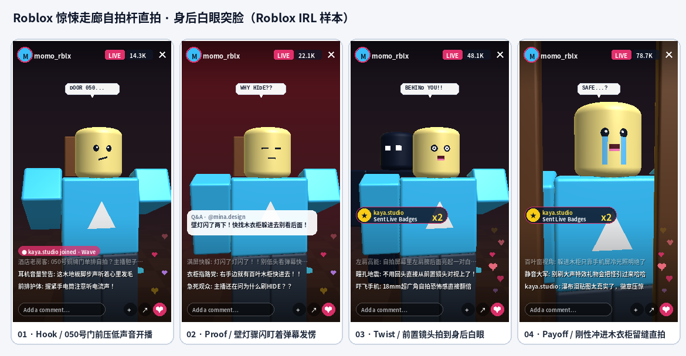
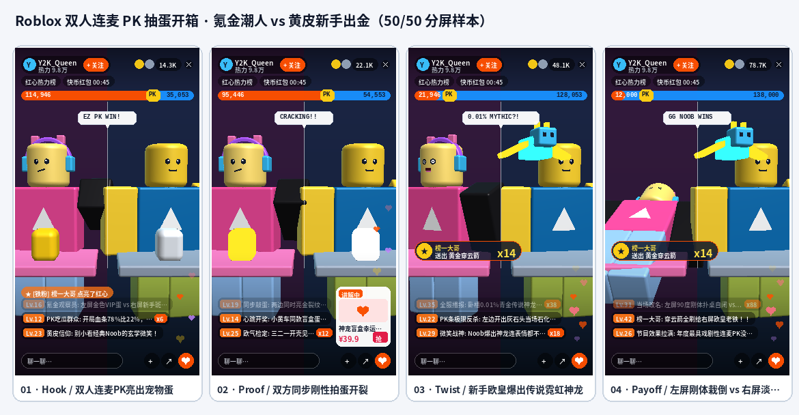
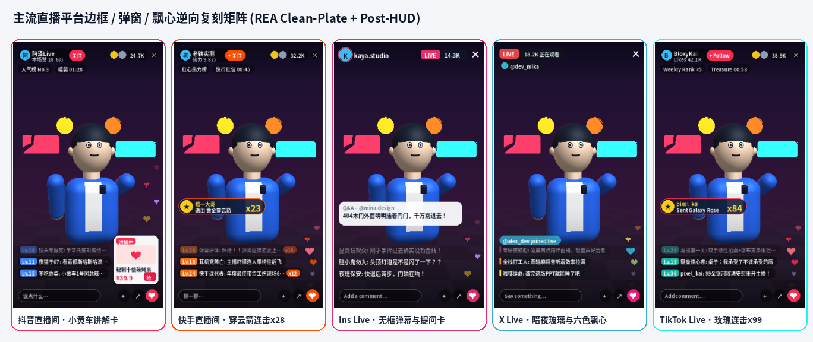
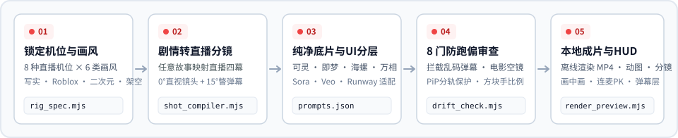
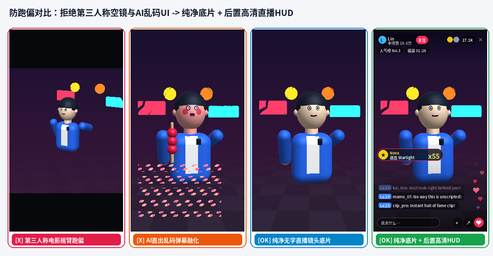

<div align="center">

# Livestream Style Video Skill

一套面向 Claude Code、Cursor、GitHub Copilot 与 Codex 的 **Agent Skill**（`SKILL.md` + 领域词库 + 零依赖命令行脚本）：把任意画风与剧情转译为 9:16 竖屏直播视角四镜分镜，编译无乱码的纯净视频生成提示词，复刻主流直播间边框特效，并在本地离线预演动态成片。

[](SKILL.md)
[](#skill-工作流与安装使用)
[](LICENSE)

**[短片示例](#短片示例)** · [分镜与直播界面](#分镜拆解与多平台直播表) · [Skill 工作流与安装](#skill-工作流与安装使用) · [Skill 指南](SKILL.md)

[English](README.md) · **简体中文** · [繁體中文](docs/i18n/README.zh-TW.md) · [日本語](docs/i18n/README.ja.md) · [한국어](docs/i18n/README.ko.md) · [Español](docs/i18n/README.es.md) · [Français](docs/i18n/README.fr.md) · [Deutsch](docs/i18n/README.de.md) · [Português](docs/i18n/README.pt-BR.md) · [Русский](docs/i18n/README.ru.md)

</div>

<a name="示例与本地-3d-预览"></a>

## 短片示例

作为可挂载的 Agent Skill，本项目在对话中可直接将任意题材与画风拆解为 15 秒、4 镜头（`9:16` 竖屏）的完整直播视角短片包，内置 8 套样本模板（5 套通用写实与跨题材 AI 视频样本 + 3 套 Roblox 方块直播样本）。下方的 **MP4** 与动图均由本 Skill 自带的 `scripts/render_preview.mjs` 在本地离线渲染，用来在调用外部付费视频模型前验证物理机位、眼神互动轴、安全区和后置直播间 HUD 弹幕特效。

<p align="center">
  <a href="examples/irl-night-market-selfie/assets/irl_night_market_selfie.mp4"></a>
  <a href="examples/desk-unboxing-autofocus/assets/desk_unboxing_autofocus.mp4"></a>
  <a href="examples/midnight-corridor-fpv-live/assets/midnight_corridor_fpv_live.mp4"></a>
  <a href="examples/late-night-study-webcam/assets/late_night_study_webcam.mp4"></a>
  <br />
  <a href="examples/wuxia-sword-flight-live/assets/wuxia_sword_flight_live.mp4"></a>
  <a href="examples/roblox-obby-rage-pip/assets/roblox_obby_rage_pip.mp4"></a>
  <a href="examples/roblox-doors-irl-selfie/assets/roblox_doors_irl_selfie.mp4"></a>
  <a href="examples/roblox-pet-hatch-pk/assets/roblox_pet_hatch_pk.mp4"></a>
</p>

## 分镜拆解与多平台直播表

视频生成模型在单个 4 至 5 秒片段里如果串联多步剧情或中途切机位，很容易退化成疏离的电影空镜或肢体穿模。每支 15 秒直播短片固定拆成四个单动作节拍（`0–3.5s` 开播立 Flag、`3.5–7.5s` 怼脸对焦实证、`7.5–11.5s` 突发直播事故、`11.5–15s` 扫弹幕破防定格）：

| 镜头 01 · 开播钩子 (`0–3.5s`) | 镜头 02 · 实拍自证 (`3.5–7.5s`) | 镜头 03 · 突发事故 (`7.5–11.5s`) | 镜头 04 · 破防收尾 (`11.5–15s`) |
| :---: | :---: | :---: | :---: |
|  |  |  |  |

六种直播机位与跨画风题材（通用写实 AI 视频、架空剧情转译与 Roblox 方块直播）的四格分镜联系表：

| 01 · 夜市超广角自拍 (`可灵` · `18mm` 手持云台与抖音边框) | 02 · 桌面微距开箱 (`即梦` · 手掌托底 `[AF-C]` 与快手边框) |
| :---: | :---: |
| <a href="examples/irl-night-market-selfie/"></a> | <a href="examples/desk-unboxing-autofocus/"></a> |
| **04 · 深夜赶工橘猫踩键盘 (`万相` · `24mm` 显示器摄像头与 X 边框)** | **06 · Roblox 天空跑酷画中画 (`海螺` · A/B 双轨与 TikTok 边框)** |
| <a href="examples/late-night-study-webcam/"></a> | <a href="examples/roblox-obby-rage-pip/"></a> |
| **07 · Roblox 走廊自拍杆 (`Sora` · 身后白眼突脸与 Ins 边框)** | **08 · Roblox 双人连麦 PK (`可灵` · 50/50 抽神龙反杀与快手边框)** |
| <a href="examples/roblox-doors-irl-selfie/"></a> | <a href="examples/roblox-pet-hatch-pk/"></a> |

内置经 REA 协议与样式逆向复刻的五大直播平台边框、交互弹窗与飘心特效（`douyin` 抖音小黄车讲解卡、`kuaishou` 快手连击弹幕与穿云箭、`instagram` 无框评论与提问置顶卡、`x` 暗夜玻璃与 Periscope 六色飘心、`tiktok` 玫瑰连击，详见[逆向台账](references/platform-ui-rea-ledger.md)），既可由命令行直接合成进成片，也可在 [`studio/index.html`](studio/index.html) 浏览器 / OBS 工作台中实时触发或绿幕导出：

<p align="center">
  
</p>

## Skill 工作流与安装使用

<p align="center">
  
</p>

### 作为 Agent Skill 安装调用

将本仓库克隆到宿主工具的 Skills 目录后，AI 编程助手会自动按需读取 [`SKILL.md`](SKILL.md) 与 [`references/`](references/) 参考手册并调用本地脚本。下方路径用于 Codex；GitHub Copilot 使用 `~/.copilot/skills/livestream-style-video`，Claude Code 与 Cursor 放入各自配置的 Skills 目录即可。

```bash
git clone https://github.com/yuzhang-zhong/livestream-style-video.git ~/.codex/skills/livestream-style-video
```

在 Agent 对话中直接调用 `livestream-style-video` Skill：

```text
使用 $livestream-style-video 把「中世纪骑士在巨龙洞口举着水晶球自拍开箱圣剑，结果惊醒身后的红龙」
规划成一支 15 秒 9:16 竖屏直播短片，套用抖音直播间小黄车讲解卡与礼物连击边框。
请给出直播机位与画风锁、4 镜头分镜表和可灵 / Sora 纯净底片图生视频提示词。
```

### 直接运行 Skill 内置命令行脚本

Skill 内附的脚本也可在普通克隆的仓库根目录独立运行，基于 Node.js 18+ 标准库，无需 `npm install` 或 API Key（配合 `python3` Pillow 与 `ffmpeg` 自动合成抗锯齿中文 HUD 与 H.264 MP4）。

```bash
node scripts/render_preview.mjs --spec templates/custom_livestream_spec.json --out-dir out/ramen-live --platform douyin --force
node scripts/shot_compiler.mjs --plot "凌晨两点街头拉面摊主边看弹幕谢礼物，身后豚骨汤突然扑锅溢出来" --platform douyin --engine kling --lang zh
node scripts/drift_check.mjs --pack templates/custom_livestream_spec.json --engine kling --lang zh
```

## Skill 脚本、防跑偏检查与参考文档

直接写「直播间画面、滚动弹幕文字」常会跑偏成第三人称电影摇臂空镜、焊死在画面像素里的外星乱码 UI、单次文生视频融化的右上角画中画，或让 Roblox 主播长出真人五指与乐高圆粒。本 Skill 将**无字纯净镜头底片**与**后置高清直播 HUD** 分层，`drift_check.mjs` 会在生成前拦截这 8 类跑偏项：

<p align="center">
  
</p>

| Skill 组件 | 输出 |
| --- | --- |
| [`SKILL.md`](SKILL.md) | Agent Skill 主入口说明，定义 6 种工作模式（机位设定、剧情转直播、提示词编译、平台 HUD、翻车修复、本地渲染）与 8 项直播视角约束。 |
| [`shot_compiler.mjs`](scripts/shot_compiler.mjs) | 支持 `--plot "<任意剧情>"`、`--spec <episode.json>` 或 8 套内置模板，生成零重复的 15s / 30s / 45s 竖屏纯净底片提示词与 HUD 时间轴（`local3d`、可灵、即梦、海螺、万相、Sora、Veo、Runway）。 |
| [`rig_spec.mjs`](scripts/rig_spec.mjs) | 锁定 8 种物理直播机位 × 6 类正交画风（写实真人、Roblox 方块、二次元 VTuber、潮玩 3D、体素沙盒、架空剧情转译）与[直播间三态参考卡](assets/showcase/rig_setup_sheet.zh.png)。 |
| [`hud_presets.mjs`](scripts/hud_presets.mjs) | 抖音、快手、Instagram Live、X、TikTok 与纯净模式的 `1080×1920` 安全区、弹幕样式、双槽礼物连击、小黄车/问答弹窗与飘心色板。 |
| [`drift_check.mjs`](scripts/drift_check.mjs) | 8 门中英 Unicode 防跑偏审查器（支持 `--prompt` 与 `--pack`），拦截电影摇臂、乱码弹幕、单轨 PiP 融化、Roblox 五指/乐高圆粒与动作超载。 |
| [`render_preview.mjs`](scripts/render_preview.mjs) | 本地 3D + 后置 HUD 视频直出引擎（`--spec <episode.json> --out-dir <dir>`），支持双轨画中画、50/50 连麦 PK 与合成现场音效 MP4 / GIF。 |
| [`studio/index.html`](studio/index.html) | 独立浏览器 / OBS 交互式直播边框工作台，内置 3 套实时 `<canvas>` 机位预演、本地 MP4 导入、弹窗触发器与 `#00FF00` 绿幕导出（[界面预览](assets/showcase/interactive_hud_studio.png)）。 |

[八大机位与光学](references/camera-rigs-and-optics.md) · [跨画风适配矩阵](references/style-adapters-matrix.md) · [任意剧情转直播节奏](references/plot-to-livestream-beats.md) · [五大平台界面逆向台账](references/platform-ui-rea-ledger.md) · [各模型提示词](references/model-prompt-playbook.md) · [跑偏修复](references/rescue-and-anti-drift.md) · [8 套分镜模板](references/viral-livestream-archetypes.md)

## 语言

Agent Skill 回复与命令行 `--lang` 支持 `en`、`zh`、`zh-tw`、`ja`、`ko`、`es`、`fr`、`de`、`pt`、`ru`。

[English](README.md) · **简体中文** · [繁體中文](docs/i18n/README.zh-TW.md) · [日本語](docs/i18n/README.ja.md) · [한국어](docs/i18n/README.ko.md) · [Español](docs/i18n/README.es.md) · [Français](docs/i18n/README.fr.md) · [Deutsch](docs/i18n/README.de.md) · [Português](docs/i18n/README.pt-BR.md) · [Русский](docs/i18n/README.ru.md)

[MIT 许可证](LICENSE)。独立开源 Agent Skill 项目，内置洁净室几何重构直播界面，不使用官方商标台标，与字节跳动、快手、Meta、X Corp. 或 Roblox Corporation 无隶属或背书关系。
