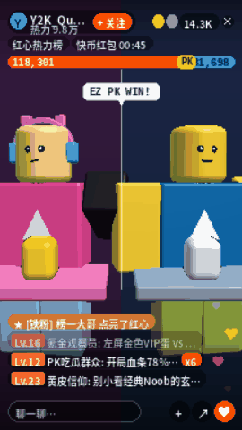
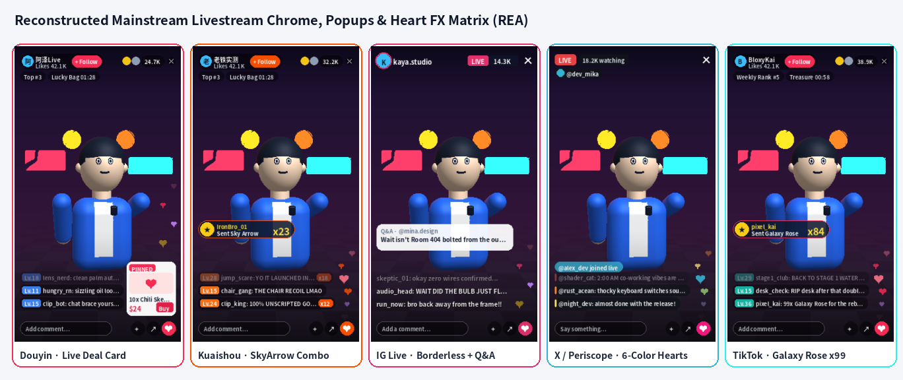

<div align="center">

# Livestream Style Video Skill

Ein **Agent Skill** (`SKILL.md` + Referenzhandbücher + abhängigkeitsfreie CLI-Tools) für Claude Code, Cursor, GitHub Copilot und Codex, der beliebige visuelle Stile oder Handlungen in vertikale `9:16`-Livestream-Shorts übersetzt, saubere Video-Prompts ohne Textsalat kompiliert, rekonstruierte Live-HUDs einblendet und Schnitte lokal vorab rendert.

[](../../SKILL.md)
[](#skill-workflow-und-schnellstart)
[](../../LICENSE)

**[Video-Beispiele](#video-beispiele)** · [Szenenboards & Live-HUDs](#szenenboards-und-schnitt-timing) · [Workflow & Schnellstart](#skill-workflow-und-schnellstart) · [Skill-Handbuch](../../SKILL.md)

[English](../../README.md) · [简体中文](../../README.zh-CN.md) · [繁體中文](README.zh-TW.md) · [日本語](README.ja.md) · [한국어](README.ko.md) · [Español](README.es.md) · [Français](README.fr.md) · **Deutsch** · [Português](README.pt-BR.md) · [Русский](README.ru.md)

</div>

## Video-Beispiele

In einem KI-Coding-Agenten aufgerufen, übersetzt dieser Skill jede Idee in ein 15-sekündiges vertikales (`9:16`) Vier-Schnitt-Livestream-Paket über acht integrierte Formate (fünf realistische & genreübergreifende KI-Video-Streams sowie drei Roblox-Blocky-Streams). Die folgenden **MP4s** und GIFs werden offline durch `scripts/render_preview.mjs` berechnet, um Kamerahalterungen, `0°/15°`-Blickachsen und Safe-Zones vor dem Einsatz externer Videomodelle zu prüfen.

<p align="center">
  <a href="../../examples/irl-night-market-selfie/assets/irl_night_market_selfie.mp4"></a>
  <a href="../../examples/desk-unboxing-autofocus/assets/desk_unboxing_autofocus.mp4"></a>
  <a href="../../examples/midnight-corridor-fpv-live/assets/midnight_corridor_fpv_live.mp4"></a>
  <a href="../../examples/late-night-study-webcam/assets/late_night_study_webcam.mp4"></a>
  <br />
  <a href="../../examples/wuxia-sword-flight-live/assets/wuxia_sword_flight_live.mp4"></a>
  <a href="../../examples/roblox-obby-rage-pip/assets/roblox_obby_rage_pip.mp4"></a>
  <a href="../../examples/roblox-doors-irl-selfie/assets/roblox_doors_irl_selfie.mp4"></a>
  <a href="../../examples/roblox-pet-hatch-pk/assets/roblox_pet_hatch_pk.mp4"></a>
</p>

## Szenenboards und Schnitt-Timing

Videomodelle verlieren das authentische Live-Gefühl, wenn ein einzelner 4–5-Sekunden-Clip mehrere Aktionen stapelt. Jeder Short teilt die Handlung in vier Einzelaktions-Beats (`0–3.5s` Live-Hook, `3.5–7.5s` Nahaufnahme-Beweis, `7.5–11.5s` ungeskripteter Zwischenfall und `11.5–15s` Chat-Reaktion):

| Shot 01 · Hook (`0–3.5s`) | Shot 02 · Beweis (`3.5–7.5s`) | Shot 03 · Twist (`7.5–11.5s`) | Shot 04 · Payoff (`11.5–15s`) |
| :---: | :---: | :---: | :---: |
|  |  |  |  |

Vier-Schnitt-Kontaktbögen über sechs Kamerarigs und Stile:

| 01 · Nachtmarkt-Selfie (`Kling` · `18mm` & Douyin HUD) | 02 · Tisch-Unboxing (`Seedance` · `[AF-C]` & Kuaishou HUD) |
| :---: | :---: |
| <a href="../../examples/irl-night-market-selfie/"></a> | <a href="../../examples/desk-unboxing-autofocus/"></a> |
| **04 · Nachtschicht-Webcam (`Wan` · `24mm` & X HUD)** | **06 · Roblox Sky-Obby + PiP (`Hailuo` · Dual-Track & TikTok HUD)** |
| <a href="../../examples/late-night-study-webcam/"></a> | <a href="../../examples/roblox-obby-rage-pip/"></a> |
| **07 · Roblox DOORS Selfie (`Sora` · `18mm` & IG HUD)** | **08 · Roblox 50/50 PK-Duell (`Kling` · Splitscreen & Kuaishou HUD)** |
| <a href="../../examples/roblox-doors-irl-selfie/"></a> | <a href="../../examples/roblox-pet-hatch-pk/"></a> |

Fünf per REA rekonstruierte Livestream-HUDs (`douyin`, `kuaishou`, `instagram`, `x`, `tiktok`, siehe [REA-Register](../../references/platform-ui-rea-ledger.md)) werden nachträglich eingeblendet oder interaktiv in [`studio/index.html`](../../studio/index.html) getestet:

<p align="center">
  
</p>

## Skill-Workflow und Schnellstart

<p align="center">
  
</p>

### Als Agent Skill installieren

Klonen Sie dieses Repository in das Skills-Verzeichnis Ihres Agenten (`~/.codex/skills/livestream-style-video` für Codex, `~/.copilot/skills/livestream-style-video` für GitHub Copilot oder den entsprechenden Ordner in Claude Code und Cursor):

```bash
git clone https://github.com/yuzhang-zhong/livestream-style-video.git ~/.codex/skills/livestream-style-video
```

Im Chat `livestream-style-video` aufrufen:

```text
Nutze $livestream-style-video, um "ein mittelalterlicher Ritter packt vor einer Drachenhöhle ein verzaubertes Schwert aus, als der Drache aufwacht"
als 15-Sekunden 9:16 Handheld-Selfie-Livestream mit Douyin-Shopping-Karte und Geschenk-Combos zu planen.
Gib mir den Kamera-Lock, ein 4-Schnitt-Storyboard und saubere Kling / Sora I2V-Prompts.
```

### CLI-Tools direkt ausführen

Alle Skripte laufen unter Node.js 18+ ausschließlich mit der Standardbibliothek (kein `npm install` und keine API-Keys):

```bash
node scripts/render_preview.mjs --spec templates/custom_livestream_spec.json --out-dir out/ramen-live --platform douyin --force
node scripts/shot_compiler.mjs --plot "Ein Ramen-Koch liest um 2 Uhr nachts den Live-Chat, während der Topf überkocht" --platform tiktok --engine kling --lang de
node scripts/drift_check.mjs --pack templates/custom_livestream_spec.json --engine kling --lang de
```

## Skill-Skripte, Anti-Drift-Prüfung und Referenzen

Generische Prompts mit „Live-Kommentaren“ erzeugen oft unbeteiligte Kamerakran-Fahrten, unleserlichen KI-Textsalat oder menschliche Finger an Roblox-Avataren. `drift_check.mjs` prüft 8 Qualitäts-Gates vor der Generierung:

<p align="center">
  
</p>

| Skill-Komponente | Ausgabe |
| --- | --- |
| [`SKILL.md`](../../SKILL.md) | Haupteinstieg mit den 6 Produktionsmodi und 8 Livestream-Invarianten. |
| [`shot_compiler.mjs`](../../scripts/shot_compiler.mjs) | Kompiliert `--plot`, `--spec` oder 8 Vorlagen in saubere 15s / 30s / 45s 9:16 Prompts + HUD-Zeitleisten. |
| [`rig_spec.mjs`](../../scripts/rig_spec.mjs) | Fixiert 8 Kamerarigs × 6 visuelle Stile und erstellt den [3-Zustands-Setup-Bogen](../../assets/showcase/rig_setup_sheet.en.png). |
| [`hud_presets.mjs`](../../scripts/hud_presets.mjs) | `1080×1920` Safe-Zones, Kommentar-Stile, Geschenk-Combos, PK-Balken und Herz-Paletten. |
| [`drift_check.mjs`](../../scripts/drift_check.mjs) | 8-Gate-Unicode-Linter gegen Kino-Drift, Textsalat, PiP-Verzerrung und Roblox-Anatomiefehler. |
| [`render_preview.mjs`](../../scripts/render_preview.mjs) | Lokaler 3D + Post-HUD `.mp4` / `.gif` Renderer inklusive synthetisiertem WAV-Audio. |
| [`studio/index.html`](../../studio/index.html) | Interaktives Browser- / OBS-HUD-Studio mit Live-`<canvas>`-Vorschau und `#00FF00` Greenscreen ([Vorschau](../../assets/showcase/interactive_hud_studio.png)). |

[Kamerarigs & Optik](../../references/camera-rigs-and-optics.md) · [Stil-Matrix](../../references/style-adapters-matrix.md) · [Handlung zu Live-Beats](../../references/plot-to-livestream-beats.md) · [REA-UI-Register](../../references/platform-ui-rea-ledger.md) · [Modell-Playbook](../../references/model-prompt-playbook.md) · [Drift-Korrekturen](../../references/rescue-and-anti-drift.md) · [8 Vorlagen](../../references/viral-livestream-archetypes.md)

## Sprachen

Agent-Antworten und `--lang` unterstützen `en`, `zh`, `zh-tw`, `ja`, `ko`, `es`, `fr`, `de`, `pt` und `ru`.

[English](../../README.md) · [简体中文](../../README.zh-CN.md) · [繁體中文](README.zh-TW.md) · [日本語](README.ja.md) · [한국어](README.ko.md) · [Español](README.es.md) · [Français](README.fr.md) · **Deutsch** · [Português](README.pt-BR.md) · [Русский](README.ru.md)

[MIT-Lizenz](../../LICENSE). Unabhängiges Open-Source-Projekt; nicht verbunden mit ByteDance, Kuaishou, Meta, X Corp. oder Roblox Corporation.
