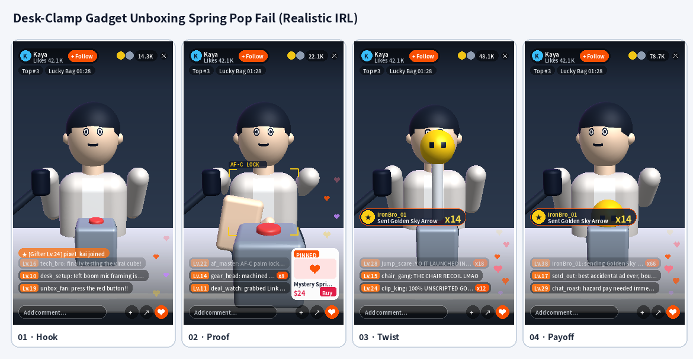

<div align="center">

# Livestream Style Video Skill

Une **Agent Skill** (`SKILL.md` + guides de référence + outils CLI sans dépendances) pour Claude Code, Cursor, GitHub Copilot et Codex permettant d'adapter tout style visuel ou scénario en courts verticaux (`9:16`) façon diffusion en direct, de compiler des prompts vidéo propres sans texte illisible, d'incruster des interfaces live grand public et de prévisualiser les plans localement.

[](../../SKILL.md)
[](#flux-de-travail-et-démarrage-rapide)
[](../../LICENSE)

**[Exemples vidéo](#exemples-vidéo)** · [Planches et HUDs live](#planches-de-scènes-et-rythme) · [Flux et démarrage rapide](#flux-de-travail-et-démarrage-rapide) · [Guide Skill](../../SKILL.md)

[English](../../README.md) · [简体中文](../../README.zh-CN.md) · [繁體中文](README.zh-TW.md) · [日本語](README.ja.md) · [한국어](README.ko.md) · [Español](README.es.md) · **Français** · [Deutsch](README.de.md) · [Português](README.pt-BR.md) · [Русский](README.ru.md)

</div>

## Exemples vidéo

Appelée depuis un agent de code, cette skill transforme une idée ou un récit en un pack vertical (`9:16`) de 15 secondes en quatre plans parmi huit formats intégrés (cinq directs IA réalistes et multi-genres plus trois directs style Roblox). Les **MP4** et GIF ci-dessous sont des animatiques 3D + Post-HUD calculées hors ligne par `scripts/render_preview.mjs` pour valider les supports caméra, les regards `0°/15°` et les zones sûres avant de lancer un modèle vidéo externe.

<p align="center">
  <a href="../../examples/irl-night-market-selfie/assets/irl_night_market_selfie.mp4"></a>
  <a href="../../examples/desk-unboxing-autofocus/assets/desk_unboxing_autofocus.mp4"></a>
  <a href="../../examples/midnight-corridor-fpv-live/assets/midnight_corridor_fpv_live.mp4"></a>
  <a href="../../examples/late-night-study-webcam/assets/late_night_study_webcam.mp4"></a>
  <br />
  <a href="../../examples/wuxia-sword-flight-live/assets/wuxia_sword_flight_live.mp4"></a>
  <a href="../../examples/roblox-obby-rage-pip/assets/roblox_obby_rage_pip.mp4"></a>
  <a href="../../examples/roblox-doors-irl-selfie/assets/roblox_doors_irl_selfie.mp4"></a>
  <a href="../../examples/roblox-pet-hatch-pk/assets/roblox_pet_hatch_pk.mp4"></a>
</p>

## Planches de scènes et rythme

Les modèles de diffusion perdent l'authenticité du direct lorsqu'un clip de 4–5 secondes cumule plusieurs actions. Chaque court découpe le récit en quatre temps à action unique (`0–3.5s` accroche directe, `3.5–7.5s` preuve rapprochée, `7.5–11.5s` imprévu en direct et `11.5–15s` réaction au chat) :

| Shot 01 · Accroche (`0–3.5s`) | Shot 02 · Preuve (`3.5–7.5s`) | Shot 03 · Imprévu (`7.5–11.5s`) | Shot 04 · Chute (`11.5–15s`) |
| :---: | :---: | :---: | :---: |
|  |  |  |  |

Planches contacts à quatre plans sur six configurations caméra et styles :

| 01 · Selfie Marché de Nuit (`Kling` · `18mm` & Douyin HUD) | 02 · Unboxing Autofocus (`Seedance` · `[AF-C]` & Kuaishou HUD) |
| :---: | :---: |
| <a href="../../examples/irl-night-market-selfie/"></a> | <a href="../../examples/desk-unboxing-autofocus/"></a> |
| **04 · Webcam Bureau (`Wan` · `24mm` & X HUD)** | **06 · Roblox Sky-Obby + PiP (`Hailuo` · Double piste & TikTok HUD)** |
| <a href="../../examples/late-night-study-webcam/"></a> | <a href="../../examples/roblox-obby-rage-pip/"></a> |
| **07 · Roblox DOORS Selfie (`Sora` · `18mm` & IG HUD)** | **08 · Roblox Duel PK 50/50 (`Kling` · Écran partagé & Kuaishou HUD)** |
| <a href="../../examples/roblox-doors-irl-selfie/"></a> | <a href="../../examples/roblox-pet-hatch-pk/"></a> |

Cinq habillages de plateformes live reconstruits via REA (`douyin`, `kuaishou`, `instagram`, `x`, `tiktok`, voir [registre REA](../../references/platform-ui-rea-ledger.md)) sont composités après coup ou pilotables en direct dans [`studio/index.html`](../../studio/index.html) :

<p align="center">
  
</p>

## Flux de travail et démarrage rapide

<p align="center">
  
</p>

### Installer comme Agent Skill

Clonez ce dépôt dans le dossier skills de votre agent (`~/.codex/skills/livestream-style-video` pour Codex, `~/.copilot/skills/livestream-style-video` pour GitHub Copilot, ou votre dossier dédié dans Claude Code et Cursor) :

```bash
git clone https://github.com/yuzhang-zhong/livestream-style-video.git ~/.codex/skills/livestream-style-video
```

Appelez `livestream-style-video` dans votre conversation :

```text
Utilise $livestream-style-video pour adapter "un chevalier médiéval déballant une épée enchantée devant l'entrée d'une grotte quand le dragon se réveille"
en un direct selfie 9:16 de 15 secondes avec carte produit et combos cadeaux Douyin.
Donne-moi le verrouillage caméra, le storyboard 4 plans et les prompts propres Kling / Sora.
```

### Exécuter les outils CLI directement

Tous les scripts tournent sous Node.js 18+ avec la bibliothèque standard uniquement (aucun `npm install` ni clé API) :

```bash
node scripts/render_preview.mjs --spec templates/custom_livestream_spec.json --out-dir out/ramen-live --platform douyin --force
node scripts/shot_compiler.mjs --plot "Un chef de ramen lit le chat en direct à 2h du matin quand le bouillon déborde" --platform tiktok --engine kling --lang fr
node scripts/drift_check.mjs --pack templates/custom_livestream_spec.json --engine kling --lang fr
```

## Scripts, contrôles anti-dérive et références

Demander directement des commentaires incrustés à un modèle vidéo provoque des plans cinéma détachés, du texte illisible ou des doigts humains sur les avatars Roblox. `drift_check.mjs` vérifie 8 garde-fous avant génération :

<p align="center">
  
</p>

| Composant Skill | Sortie |
| --- | --- |
| [`SKILL.md`](../../SKILL.md) | Point d'entrée définissant les 6 modes de production et les 8 invariants livestream. |
| [`shot_compiler.mjs`](../../scripts/shot_compiler.mjs) | Compile `--plot`, `--spec` ou 8 modèles en prompts propres 9:16 (15s / 30s / 45s) et chronologies HUD. |
| [`rig_spec.mjs`](../../scripts/rig_spec.mjs) | Verrouille 8 supports caméra × 6 styles visuels et génère la [planche 3 états](../../assets/showcase/rig_setup_sheet.en.png). |
| [`hud_presets.mjs`](../../scripts/hud_presets.mjs) | Zones sûres `1080×1920`, styles de chat, combos cadeaux, barres PK et palettes de cœurs. |
| [`drift_check.mjs`](../../scripts/drift_check.mjs) | Linter Unicode à 8 portes détectant dérive cinéma, UI corrompue, fonte PiP et défauts Roblox. |
| [`render_preview.mjs`](../../scripts/render_preview.mjs) | Moteur local 3D + Post-HUD `.mp4` / `.gif` avec audio WAV synthétisé. |
| [`studio/index.html`](../../studio/index.html) | Studio interactif navigateur / OBS avec aperçu `<canvas>` et fond vert `#00FF00` ([aperçu](../../assets/showcase/interactive_hud_studio.png)). |

[Caméras et optique](../../references/camera-rigs-and-optics.md) · [Matrice des styles](../../references/style-adapters-matrix.md) · [Intrigue vers temps live](../../references/plot-to-livestream-beats.md) · [Registre REA des interfaces](../../references/platform-ui-rea-ledger.md) · [Guide des modèles](../../references/model-prompt-playbook.md) · [Corrections anti-dérive](../../references/rescue-and-anti-drift.md) · [8 modèles](../../references/viral-livestream-archetypes.md)

## Langues

Les réponses de l'agent et `--lang` prennent en charge `en`, `zh`, `zh-tw`, `ja`, `ko`, `es`, `fr`, `de`, `pt` et `ru`.

[English](../../README.md) · [简体中文](../../README.zh-CN.md) · [繁體中文](README.zh-TW.md) · [日本語](README.ja.md) · [한국어](README.ko.md) · [Español](README.es.md) · **Français** · [Deutsch](README.de.md) · [Português](README.pt-BR.md) · [Русский](README.ru.md)

[Licence MIT](../../LICENSE). Agent Skill open-source indépendante ; non affiliée à ByteDance, Kuaishou, Meta, X Corp. ou Roblox Corporation.
