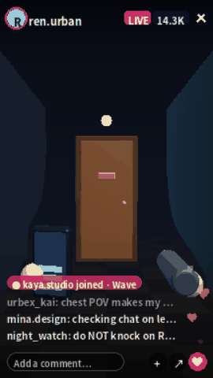
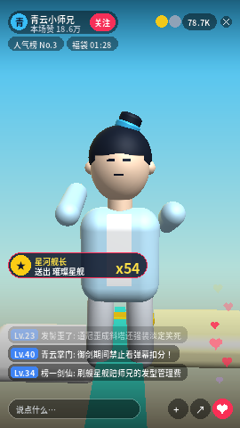
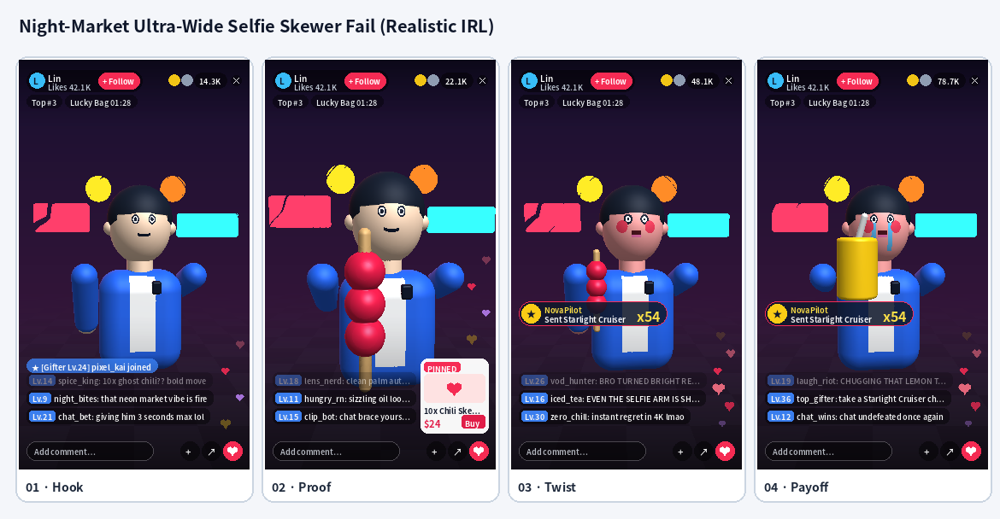
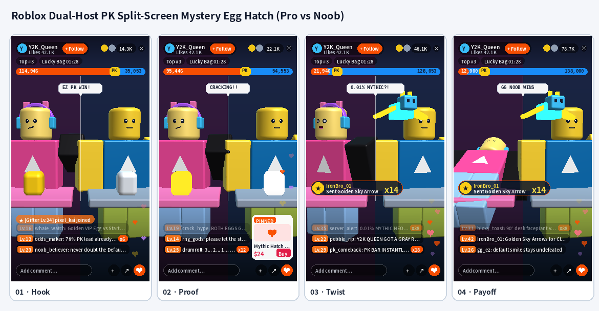

<div align="center">

# Livestream Style Video Skill

Claude Code・Cursor・GitHub Copilot・Codex 向けの **Agent Skill**（`SKILL.md` + リファレンスガイド + 依存関係ゼロの CLI ツール）。あらゆる画風やストーリーを 9:16 縦型ライブ配信視点の 4 カット構成に変換し、文字化けゼロのクリーンプレートプロンプト生成、主要配信プラットフォーム枠の重ね合わせ、ローカル 3D プレビューを一貫して行います。

[](../../SKILL.md)
[](#skill-ワークフローとクイックスタート)
[](../../LICENSE)

**[動画サンプル](#動画サンプル)** · [シーンボードと配信HUD](#シーンボードとカット割り) · [ワークフローと導入](#skill-ワークフローとクイックスタート) · [Skill ガイド](../../SKILL.md)

[English](../../README.md) · [简体中文](../../README.zh-CN.md) · [繁體中文](README.zh-TW.md) · **日本語** · [한국어](README.ko.md) · [Español](README.es.md) · [Français](README.fr.md) · [Deutsch](README.de.md) · [Português](README.pt-BR.md) · [Русский](README.ru.md)

</div>

## 動画サンプル

AI コーディングエージェントから呼び出すと、任意の画風やプロットを 8 種類の内蔵フォーマット（実写・異世界変換 AI 動画 5 種 + Roblox ブロック配信 3 種）に沿った 15 秒・4 カットの縦型（`9:16`）パッケージへ変換します。以下の **MP4** と GIF は同梱の `scripts/render_preview.mjs` でオフライン描画した 3D + Post-HUD アニマティクスで、外部の動画生成モデルを実行する前にカメラマウント、視線誘導、セーフゾーンを確認できます。

<p align="center">
  <a href="../../examples/irl-night-market-selfie/assets/irl_night_market_selfie.mp4"></a>
  <a href="../../examples/desk-unboxing-autofocus/assets/desk_unboxing_autofocus.mp4"></a>
  <a href="../../examples/midnight-corridor-fpv-live/assets/midnight_corridor_fpv_live.mp4"></a>
  <a href="../../examples/late-night-study-webcam/assets/late_night_study_webcam.mp4"></a>
  <br />
  <a href="../../examples/wuxia-sword-flight-live/assets/wuxia_sword_flight_live.mp4"></a>
  <a href="../../examples/roblox-obby-rage-pip/assets/roblox_obby_rage_pip.mp4"></a>
  <a href="../../examples/roblox-doors-irl-selfie/assets/roblox_doors_irl_selfie.mp4"></a>
  <a href="../../examples/roblox-pet-hatch-pk/assets/roblox_pet_hatch_pk.mp4"></a>
</p>

## シーンボードとカット割り

4〜5 秒の単一クリップに複数の連続動作を詰め込むと、物理カメラの臨場感が崩れやすくなります。各ライブショートは「1 カット 1 アクション」の 4 ビート（`0–3.5s` 開始フック、`3.5–7.5s` 接写実証、`7.5–11.5s` 放送ハプニング、`11.5–15s` コメント欄リアクション）に分割しています：

| Shot 01 · フック (`0–3.5s`) | Shot 02 · 実証 (`3.5–7.5s`) | Shot 03 · 急展開 (`7.5–11.5s`) | Shot 04 · オチ (`11.5–15s`) |
| :---: | :---: | :---: | :---: |
|  |  |  |  |

6 つのカメラリグ・画風別の 4 カット絵コンテシート：

| 01 · 夜市セルフィー (`Kling` · `18mm` ＆ Douyin HUD) | 02 · 卓上AF開封 (`Seedance` · `[AF-C]` ＆ Kuaishou HUD) |
| :---: | :---: |
| <a href="../../examples/irl-night-market-selfie/"></a> | <a href="../../examples/desk-unboxing-autofocus/"></a> |
| **04 · 深夜作業Webカメラ (`Wan` · `24mm` ＆ X HUD)** | **06 · Roblox Sky-Obby + PiP (`Hailuo` · 2トラック ＆ TikTok HUD)** |
| <a href="../../examples/late-night-study-webcam/"></a> | <a href="../../examples/roblox-obby-rage-pip/"></a> |
| **07 · Roblox DOORS セルフィー (`Sora` · `18mm` ＆ IG HUD)** | **08 · Roblox 50/50 コラボPK (`Kling` · 分割対決 ＆ Kuaishou HUD)** |
| <a href="../../examples/roblox-doors-irl-selfie/"></a> | <a href="../../examples/roblox-pet-hatch-pk/"></a> |

REA 解析に基づき再現した 5 大配信プラットフォーム HUD（`douyin`・`kuaishou`・`instagram`・`x`・`tiktok`、[詳細台帳](../../references/platform-ui-rea-ledger.md)）は、ブラウザ / OBS 用 [`studio/index.html`](../../studio/index.html) でもインタラクティブに操作できます：

<p align="center">
  
</p>

## Skill ワークフローとクイックスタート

<p align="center">
  
</p>

### Agent Skill として導入する

お使いのエージェントの skills ディレクトリにクローンします。以下のパスは Codex 用です（GitHub Copilot は `~/.copilot/skills/livestream-style-video`、Claude Code や Cursor は各ツールの skills フォルダを使用してください）。

```bash
git clone https://github.com/yuzhang-zhong/livestream-style-video.git ~/.codex/skills/livestream-style-video
```

チャットから `livestream-style-video` スキルを呼び出します：

```text
$livestream-style-video を使って、「ドラゴンの洞窟前で聖剣を開封配信していた中世騎士が背後の赤竜を起こしてしまう」話を
15秒・9:16 の手持ちセルフィー配信動画（Douyin 商品カード＆ギフト連撃枠付き）に設計して。
カメラリグ固定カード、4カット絵コンテ、Kling / Sora 用のクリーンプレート I2V プロンプトを出して。
```

### 同梱 CLI ツールを直接実行する

リポジトリ直下から Node.js 18+ 標準ライブラリのみで実行できます（`npm install` や API キー不要）。

```bash
node scripts/render_preview.mjs --spec templates/custom_livestream_spec.json --out-dir out/ramen-live --platform douyin --force
node scripts/shot_compiler.mjs --plot "深夜2時の屋台ラーメン店主がコメントを読んでいる隙にスープが吹きこぼれる" --platform douyin --engine kling --lang ja
node scripts/drift_check.mjs --pack templates/custom_livestream_spec.json --engine kling --lang ja
```

## Skill スクリプト・ドリフト防止・リファレンス

動画生成モデルに直接「配信コメント欄」を描かせると、三人称の映画カメラ化や文字化け UI、Roblox 配信者の 5 本指化が起きがちです。`drift_check.mjs` が生成前に 8 ゲートでスタイル崩れを検出します：

<p align="center">
  
</p>

| Skill コンポーネント | 出力内容 |
| --- | --- |
| [`SKILL.md`](../../SKILL.md) | 6 つの制作モードと 8 つのライブ配信ルールを定義するエントリガイド。 |
| [`shot_compiler.mjs`](../../scripts/shot_compiler.mjs) | `--plot` 自由入力・`--spec`・8 種のテンプレートから 9:16 クリーンプレートプロンプトと HUD タイムラインを生成。 |
| [`rig_spec.mjs`](../../scripts/rig_spec.mjs) | 8 種のカメラリグ × 6 種の画風ロックと [3状態セットアップシート](../../assets/showcase/rig_setup_sheet.en.png)プロンプトを生成。 |
| [`hud_presets.mjs`](../../scripts/hud_presets.mjs) | 5 大配信枠の `1080×1920` セーフゾーン、コメント、ギフト連撃、PK ゲージ定義。 |
| [`drift_check.mjs`](../../scripts/drift_check.mjs) | 映画カメラ化・文字化け UI・PiP 崩壊・Roblox 形状崩れを検査する 8 ゲートリンター。 |
| [`render_preview.mjs`](../../scripts/render_preview.mjs) | ローカル 3D + Post-HUD `.mp4` / `.gif` / 絵コンテシート描画エンジン。 |
| [`studio/index.html`](../../studio/index.html) | ブラウザ / OBS 対応のインタラクティブ配信 HUD スタジオ（[プレビュー](../../assets/showcase/interactive_hud_studio.png)）。 |

[カメラリグと光学](../../references/camera-rigs-and-optics.md) · [スタイル変換マトリクス](../../references/style-adapters-matrix.md) · [プロット4幕変換](../../references/plot-to-livestream-beats.md) · [REA 配信UI台帳](../../references/platform-ui-rea-ledger.md) · [モデル別プロンプト集](../../references/model-prompt-playbook.md) · [ドリフト修正ガイド](../../references/rescue-and-anti-drift.md) · [8種のテンプレート](../../references/viral-livestream-archetypes.md)

## 対応言語

Agent Skill の応答および CLI の `--lang` オプションは `en`・`zh`・`zh-tw`・`ja`・`ko`・`es`・`fr`・`de`・`pt`・`ru` の 10 言語に対応しています。

[English](../../README.md) · [简体中文](../../README.zh-CN.md) · [繁體中文](README.zh-TW.md) · **日本語** · [한국어](README.ko.md) · [Español](README.es.md) · [Français](README.fr.md) · [Deutsch](README.de.md) · [Português](README.pt-BR.md) · [Русский](README.ru.md)

[MIT License](../../LICENSE)。クリーンルーム設計による独立オープンソースの Agent Skill であり、ByteDance・Kuaishou・Meta・X Corp.・Roblox Corporation とは提携していません。
