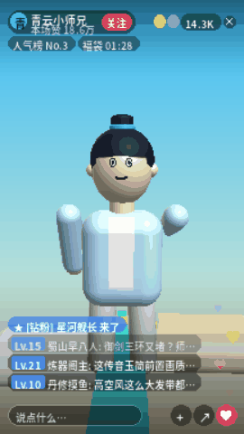
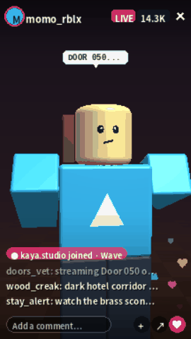
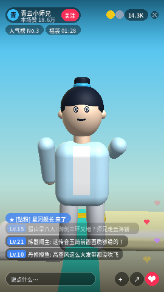

<div align="center">

# Livestream Style Video Skill

Claude Code, Cursor, GitHub Copilot, Codex용 **Agent Skill**(`SKILL.md` + 레퍼런스 가이드 + 무의존성 CLI 도구): 어떤 화풍과 줄거리든 9:16 세로형 라이브 방송 시점 4컷 스토리보드로 변환하고, 깨진 글자 없는 클린 플레이트 프롬프트 컴파일, 주요 라이브 플랫폼 HUD 오버레이 및 로컬 3D 프리뷰를 수행합니다.

[](../../SKILL.md)
[](#skill-워크플로-및-빠른-시작)
[](../../LICENSE)

**[비디오 예시](#비디오-예시)** · [씬 보드 & 라이브 HUD](#씬-보드-및-컷-호흡) · [워크플로 및 설치](#skill-워크플로-및-빠른-시작) · [Skill 가이드](../../SKILL.md)

[English](../../README.md) · [简体中文](../../README.zh-CN.md) · [繁體中文](README.zh-TW.md) · [日本語](README.ja.md) · **한국어** · [Español](README.es.md) · [Français](README.fr.md) · [Deutsch](README.de.md) · [Português](README.pt-BR.md) · [Русский](README.ru.md)

</div>

## 비디오 예시

AI 코딩 에이전트에서 호출하면 어떤 아이디어든 8가지 내장 포맷(실사·장르 변환 AI 비디오 5종 + Roblox 블록 라이브 3종)에 맞춘 15초·4컷 세로형(`9:16`) 패키지로 변환합니다. 아래 **MP4**와 GIF는 `scripts/render_preview.mjs`가 로컬에서 렌더링한 3D + Post-HUD 프리뷰로, 외부 비디오 생성 모델을 실행하기 전에 카메라 마운트, 시선 처리, 안전 영역을 검증할 수 있습니다.

<p align="center">
  <a href="../../examples/irl-night-market-selfie/assets/irl_night_market_selfie.mp4"></a>
  <a href="../../examples/desk-unboxing-autofocus/assets/desk_unboxing_autofocus.mp4"></a>
  <a href="../../examples/midnight-corridor-fpv-live/assets/midnight_corridor_fpv_live.mp4"></a>
  <a href="../../examples/late-night-study-webcam/assets/late_night_study_webcam.mp4"></a>
  <br />
  <a href="../../examples/wuxia-sword-flight-live/assets/wuxia_sword_flight_live.mp4"></a>
  <a href="../../examples/roblox-obby-rage-pip/assets/roblox_obby_rage_pip.mp4"></a>
  <a href="../../examples/roblox-doors-irl-selfie/assets/roblox_doors_irl_selfie.mp4"></a>
  <a href="../../examples/roblox-pet-hatch-pk/assets/roblox_pet_hatch_pk.mp4"></a>
</p>

## 씬 보드 및 컷 호흡

4~5초 클립 하나에 여러 연속 동작을 넣으면 라이브 카메라의 물리적 현장감이 무너집니다. 모든 쇼츠는 1컷 1액션의 4비트(`0–3.5s` 오프닝 훅, `3.5–7.5s` 근접 초점 검증, `7.5–11.5s` 돌발 방송 사고, `11.5–15s` 채팅창 리액션)로 분할됩니다:

| Shot 01 · 훅 (`0–3.5s`) | Shot 02 · 검증 (`3.5–7.5s`) | Shot 03 · 반전 (`7.5–11.5s`) | Shot 04 · 엔딩 (`11.5–15s`) |
| :---: | :---: | :---: | :---: |
|  |  |  |  |

6가지 대표 카메라 리그 및 화풍별 4컷 컨택트 시트:

| 01 · 야시장 셀카 (`Kling` · `18mm` 짐벌 & Douyin HUD) | 02 · 데스크 AF 언박싱 (`Seedance` · `[AF-C]` & Kuaishou HUD) |
| :---: | :---: |
| <a href="../../examples/irl-night-market-selfie/"></a> | <a href="../../examples/desk-unboxing-autofocus/"></a> |
| **04 · 새벽 작업 웹캠 (`Wan` · `24mm` 모니터캠 & X HUD)** | **06 · Roblox 점프맵 + PiP (`Hailuo` · 듀얼 트랙 & TikTok HUD)** |
| <a href="../../examples/late-night-study-webcam/"></a> | <a href="../../examples/roblox-obby-rage-pip/"></a> |
| **07 · Roblox DOORS 셀카봉 (`Sora` · `18mm` & IG HUD)** | **08 · Roblox 50/50 합방 PK (`Kling` · 분할 대결 & Kuaishou HUD)** |
| <a href="../../examples/roblox-doors-irl-selfie/"></a> | <a href="../../examples/roblox-pet-hatch-pk/"></a> |

REA 분석을 바탕으로 재구성한 5대 라이브 플랫폼 HUD(`douyin`, `kuaishou`, `instagram`, `x`, `tiktok`, [REA 원장](../../references/platform-ui-rea-ledger.md))는 브라우저 / OBS용 [`studio/index.html`](../../studio/index.html)에서도 실시간으로 조작할 수 있습니다:

<p align="center">
  
</p>

## Skill 워크플로 및 빠른 시작

<p align="center">
  
</p>

### Agent Skill로 설치하기

에이전트 호스트의 skills 디렉터리에 클론합니다. 아래 경로는 Codex 기준이며, GitHub Copilot은 `~/.copilot/skills/livestream-style-video`, Claude Code와 Cursor는 각 도구의 skills 폴더를 사용하세요.

```bash
git clone https://github.com/yuzhang-zhong/livestream-style-video.git ~/.codex/skills/livestream-style-video
```

에이전트 채팅에서 `livestream-style-video` 호출:

```text
$livestream-style-video 를 사용해 "드래곤 동굴 입구에서 마법검을 언박싱하다가 뒤에서 잠든 레드 드래곤을 깨우는 중세 기사" 이야기를
15초 9:16 핸드헬드 셀카 라이브 영상(도우인 쇼핑 카드 & 선물 콤보 오버레이)으로 기획해 줘.
카메라 리그 설정 카드, 4컷 클린 플레이트 스토리보드, Kling / Sora I2V 프롬프트를 출력해 줘.
```

### 내장 CLI 도구 직접 실행하기

Node.js 18+ 표준 라이브러리만으로 독립 실행됩니다(`npm install` 및 API 키 불필요).

```bash
node scripts/render_preview.mjs --spec templates/custom_livestream_spec.json --out-dir out/ramen-live --platform douyin --force
node scripts/shot_compiler.mjs --plot "새벽 2시 포장마차 라멘 요리사가 채팅을 읽다가 육수가 넘치는 방송 사고" --platform douyin --engine kling --lang ko
node scripts/drift_check.mjs --pack templates/custom_livestream_spec.json --engine kling --lang ko
```

## Skill 스크립트, 드리프트 체크 및 레퍼런스

비디오 생성 모델에 직접 "라이브 채팅창"을 프롬프트하면 3인칭 영화 크레인 샷으로 변질되거나 외계어 UI 깨짐, Roblox 스트리머의 사람 손가락 생성이 발생합니다. `drift_check.mjs`가 생성 전 8개 게이트로 이를 차단합니다:

<p align="center">
  
</p>

| Skill 컴포넌트 | 출력 |
| --- | --- |
| [`SKILL.md`](../../SKILL.md) | 6가지 제작 모드와 8가지 라이브 시점 불변 규칙을 정의하는 메인 진입점. |
| [`shot_compiler.mjs`](../../scripts/shot_compiler.mjs) | `--plot`, `--spec`, 8종 템플릿을 15s / 30s / 45s 9:16 클린 플레이트 프롬프트 및 HUD 타임라인으로 컴파일. |
| [`rig_spec.mjs`](../../scripts/rig_spec.mjs) | 8종 물리 카메라 리그 × 6종 화풍 팩 고정 및 [3상태 셋업 시트](../../assets/showcase/rig_setup_sheet.en.png) 프롬프트 생성. |
| [`hud_presets.mjs`](../../scripts/hud_presets.mjs) | 5대 플랫폼 `1080×1920` 안전 영역, 댓글 스타일, 선물 콤보, PK 바, 하트 색상표. |
| [`drift_check.mjs`](../../scripts/drift_check.mjs) | 3인칭 영화 드리프트, 깨진 UI, PiP 왜곡, Roblox 다섯 손가락을 잡아내는 8게이트 린터. |
| [`render_preview.mjs`](../../scripts/render_preview.mjs) | 로컬 3D + Post-HUD `.mp4` / `.gif` / 컨택트 시트 렌더러. |
| [`studio/index.html`](../../studio/index.html) | 브라우저 / OBS용 인터랙티브 라이브 HUD 스튜디오([미리보기](../../assets/showcase/interactive_hud_studio.png)). |

[카메라 리그 및 광학](../../references/camera-rigs-and-optics.md) · [화풍 어댑터 매트릭스](../../references/style-adapters-matrix.md) · [줄거리→라이브 비트](../../references/plot-to-livestream-beats.md) · [REA 플랫폼 UI 원장](../../references/platform-ui-rea-ledger.md) · [모델 프롬프트 가이드](../../references/model-prompt-playbook.md) · [드리프트 수정](../../references/rescue-and-anti-drift.md) · [8종 템플릿](../../references/viral-livestream-archetypes.md)

## 지원 언어

Agent Skill 응답 및 CLI `--lang` 옵션은 `en`, `zh`, `zh-tw`, `ja`, `ko`, `es`, `fr`, `de`, `pt`, `ru`를 지원합니다.

[English](../../README.md) · [简体中文](../../README.zh-CN.md) · [繁體中文](README.zh-TW.md) · [日本語](README.ja.md) · **한국어** · [Español](README.es.md) · [Français](README.fr.md) · [Deutsch](README.de.md) · [Português](README.pt-BR.md) · [Русский](README.ru.md)

[MIT License](../../LICENSE). 클린룸 기하 UI 재구성을 사용하는 독립 오픈소스 Agent Skill이며 ByteDance, Kuaishou, Meta, X Corp., Roblox Corporation과 무관합니다.
