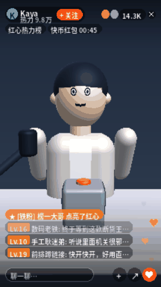
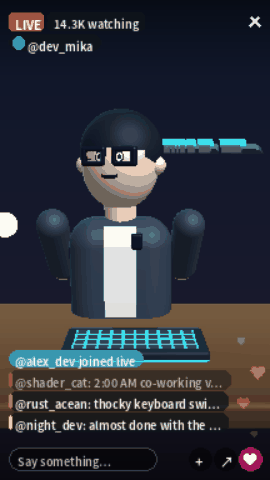
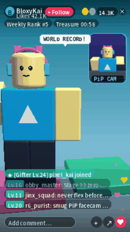
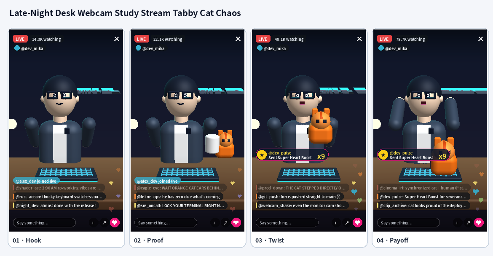
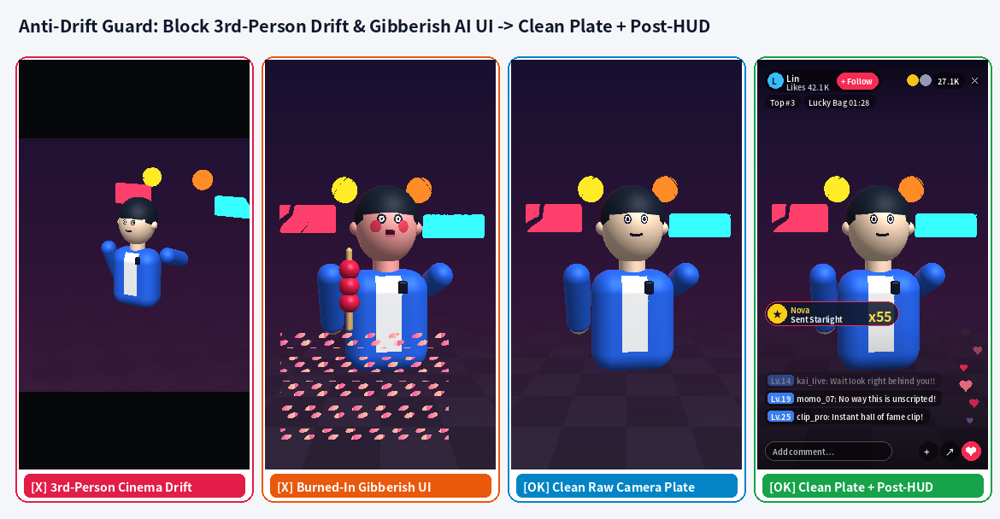

<div align="center">

# Livestream Style Video Skill

Uma **Agent Skill** (`SKILL.md` + guias de referência + ferramentas CLI sem dependências) para Claude Code, Cursor, GitHub Copilot e Codex que adapta qualquer estilo visual ou enredo em vídeos curtos verticais (`9:16`) com perspectiva de live, compila prompts limpos sem texto embaralhado, sobrepõe interfaces de transmissão e renderiza prévias localmente.

[](../../SKILL.md)
[](#fluxo-de-trabalho-e-início-rápido)
[](../../LICENSE)

**[Exemplos em vídeo](#exemplos-em-vídeo)** · [Pranchas e HUDs ao vivo](#pranchas-de-cenas-e-ritmo-de-cortes) · [Fluxo e início rápido](#fluxo-de-trabalho-e-início-rápido) · [Guia da Skill](../../SKILL.md)

[English](../../README.md) · [简体中文](../../README.zh-CN.md) · [繁體中文](README.zh-TW.md) · [日本語](README.ja.md) · [한국어](README.ko.md) · [Español](README.es.md) · [Français](README.fr.md) · [Deutsch](README.de.md) · **Português** · [Русский](README.ru.md)

</div>

## Exemplos em vídeo

Quando acionada em um agente de programação, esta skill transforma qualquer ideia ou enredo em um pacote vertical (`9:16`) de 15 segundos e quatro planos entre oito formatos integrados (cinco lives realistas e de fantasia mais três lives estilo Roblox). Os **MP4s** e GIFs abaixo são animáticas 3D + Post-HUD geradas offline por `scripts/render_preview.mjs` para validar suportes físicos de câmera, olhares `0°/15°` e áreas seguras antes de gastar créditos em modelos externos.

<p align="center">
  <a href="../../examples/irl-night-market-selfie/assets/irl_night_market_selfie.mp4"></a>
  <a href="../../examples/desk-unboxing-autofocus/assets/desk_unboxing_autofocus.mp4"></a>
  <a href="../../examples/midnight-corridor-fpv-live/assets/midnight_corridor_fpv_live.mp4"></a>
  <a href="../../examples/late-night-study-webcam/assets/late_night_study_webcam.mp4"></a>
  <br />
  <a href="../../examples/wuxia-sword-flight-live/assets/wuxia_sword_flight_live.mp4"></a>
  <a href="../../examples/roblox-obby-rage-pip/assets/roblox_obby_rage_pip.mp4"></a>
  <a href="../../examples/roblox-doors-irl-selfie/assets/roblox_doors_irl_selfie.mp4"></a>
  <a href="../../examples/roblox-pet-hatch-pk/assets/roblox_pet_hatch_pk.mp4"></a>
</p>

## Pranchas de cenas e ritmo de cortes

Modelos de difusão perdem a sensação física de live quando um clipe de 4–5 segundos empilha várias ações. Cada vídeo divide a história em quatro batidas de ação única (`0–3.5s` gancho inicial, `3.5–7.5s` prova macro na lente, `7.5–11.5s` reviravolta ao vivo e `11.5–15s` reação ao chat):

| Shot 01 · Gancho (`0–3.5s`) | Shot 02 · Prova (`3.5–7.5s`) | Shot 03 · Giro (`7.5–11.5s`) | Shot 04 · Desfecho (`11.5–15s`) |
| :---: | :---: | :---: | :---: |
|  |  |  |  |

Folhas de contato de quatro planos em seis câmeras e estilos visuais:

| 01 · Selfie Feira Noturna (`Kling` · `18mm` & Douyin HUD) | 02 · Unboxing Autofoco (`Seedance` · `[AF-C]` & Kuaishou HUD) |
| :---: | :---: |
| <a href="../../examples/irl-night-market-selfie/"></a> | <a href="../../examples/desk-unboxing-autofocus/"></a> |
| **04 · Webcam Noturna (`Wan` · `24mm` & X HUD)** | **06 · Roblox Sky-Obby + PiP (`Hailuo` · Pista dupla & TikTok HUD)** |
| <a href="../../examples/late-night-study-webcam/"></a> | <a href="../../examples/roblox-obby-rage-pip/"></a> |
| **07 · Roblox DOORS Selfie (`Sora` · `18mm` & IG HUD)** | **08 · Roblox Duelo PK 50/50 (`Kling` · Tela dividida & Kuaishou HUD)** |
| <a href="../../examples/roblox-doors-irl-selfie/"></a> | <a href="../../examples/roblox-pet-hatch-pk/"></a> |

Cinco interfaces de plataformas reconstruídas via REA (`douyin`, `kuaishou`, `instagram`, `x`, `tiktok`, veja o [registro REA](../../references/platform-ui-rea-ledger.md)) são sobrepostas após gerar o vídeo limpo ou testadas ao vivo em [`studio/index.html`](../../studio/index.html):

<p align="center">
  
</p>

## Fluxo de trabalho e início rápido

<p align="center">
  
</p>

### Instalar como Agent Skill

Clone este repositório na pasta de skills do seu agente (`~/.codex/skills/livestream-style-video` no Codex, `~/.copilot/skills/livestream-style-video` no GitHub Copilot, ou sua pasta configurada no Claude Code e Cursor):

```bash
git clone https://github.com/yuzhang-zhong/livestream-style-video.git ~/.codex/skills/livestream-style-video
```

Acione `livestream-style-video` no chat:

```text
Use $livestream-style-video para adaptar "um cavaleiro medieval fazendo unboxing de uma espada encantada na entrada da caverna de um dragão quando o dragão acorda"
em uma live selfie 9:16 de 15 segundos com card de compras e combos do Douyin.
Me entregue a trava de câmera, storyboard de 4 planos e prompts limpos para Kling / Sora.
```

### Executar ferramentas CLI diretamente

Todos os scripts rodam em Node.js 18+ usando apenas a biblioteca padrão (sem `npm install` nem chaves de API):

```bash
node scripts/render_preview.mjs --spec templates/custom_livestream_spec.json --out-dir out/ramen-live --platform douyin --force
node scripts/shot_compiler.mjs --plot "Chef de lámen lê o chat ao vivo às 2h da manhã quando a panela transborda" --platform tiktok --engine kling --lang pt
node scripts/drift_check.mjs --pack templates/custom_livestream_spec.json --engine kling --lang pt
```

## Scripts, verificação anti-desvio e referências

Pedir comentários de live diretamente ao modelo de vídeo gera planos de cinema distantes, texto corrompido ou dedos humanos em avatares Roblox. `drift_check.mjs` valida 8 barreiras antes da geração:

<p align="center">
  
</p>

| Componente | Saída |
| --- | --- |
| [`SKILL.md`](../../SKILL.md) | Entrada principal definindo os 6 modos de produção e 8 invariantes de live. |
| [`shot_compiler.mjs`](../../scripts/shot_compiler.mjs) | Compila `--plot`, `--spec` ou 8 modelos em prompts limpos 9:16 (15s / 30s / 45s) e linhas do tempo HUD. |
| [`rig_spec.mjs`](../../scripts/rig_spec.mjs) | Trava 8 câmeras × 6 estilos visuais e gera a [prancha de referência em 3 estados](../../assets/showcase/rig_setup_sheet.en.png). |
| [`hud_presets.mjs`](../../scripts/hud_presets.mjs) | Zonas seguras `1080×1920`, estilos de chat, combos de presentes, barras PK e paletas de corações. |
| [`drift_check.mjs`](../../scripts/drift_check.mjs) | Linter Unicode de 8 portas contra desvio cinematográfico, UI embaralhada, fusão PiP e erros Roblox. |
| [`render_preview.mjs`](../../scripts/render_preview.mjs) | Renderizador local 3D + Post-HUD `.mp4` / `.gif` com áudio WAV sintetizado. |
| [`studio/index.html`](../../studio/index.html) | Estúdio interativo para navegador / OBS com prévia `<canvas>` e exportação chroma `#00FF00` ([prévia](../../assets/showcase/interactive_hud_studio.png)). |

[Câmeras e óptica](../../references/camera-rigs-and-optics.md) · [Matriz de estilos](../../references/style-adapters-matrix.md) · [Enredo para batidas ao vivo](../../references/plot-to-livestream-beats.md) · [Registro REA de UI](../../references/platform-ui-rea-ledger.md) · [Prompts por modelo](../../references/model-prompt-playbook.md) · [Correções anti-desvio](../../references/rescue-and-anti-drift.md) · [8 modelos](../../references/viral-livestream-archetypes.md)

## Idiomas

As respostas do agente e `--lang` suportam `en`, `zh`, `zh-tw`, `ja`, `ko`, `es`, `fr`, `de`, `pt` e `ru`.

[English](../../README.md) · [简体中文](../../README.zh-CN.md) · [繁體中文](README.zh-TW.md) · [日本語](README.ja.md) · [한국어](README.ko.md) · [Español](README.es.md) · [Français](README.fr.md) · [Deutsch](README.de.md) · **Português** · [Русский](README.ru.md)

[Licença MIT](../../LICENSE). Agent Skill independente de código aberto; sem afiliação com ByteDance, Kuaishou, Meta, X Corp. ou Roblox Corporation.
