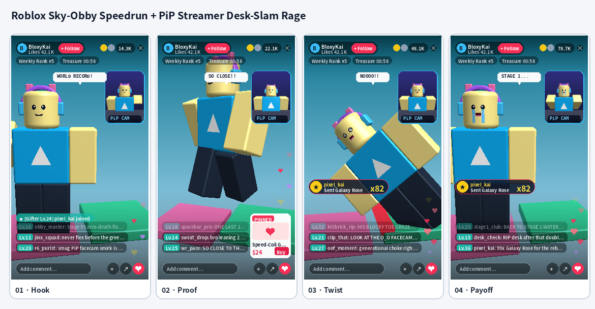
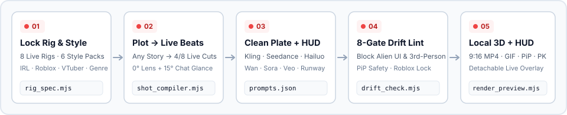

<div align="center">

# Livestream Style Video Skill

**Agent Skill** (`SKILL.md` + справочные руководства + CLI-инструменты без зависимостей) для Claude Code, Cursor, GitHub Copilot и Codex: переводит любой визуальный стиль и сюжет в вертикальные (`9:16`) короткие видео с ракурсом прямого эфира, компилирует чистые промпты без искажённого текста, накладывает реконструированные интерфейсы стримов и рендерит локальные превью.

[](../../SKILL.md)
[](#рабочий-процесс-и-быстрый-старт)
[](../../LICENSE)

**[Примеры видео](#примеры-видео)** · [Раскадровки и HUD](#раскадровки-и-ритм-планов) · [Пайплайн и старт](#рабочий-процесс-и-быстрый-старт) · [Руководство Skill](../../SKILL.md)

[English](../../README.md) · [简体中文](../../README.zh-CN.md) · [繁體中文](README.zh-TW.md) · [日本語](README.ja.md) · [한국어](README.ko.md) · [Español](README.es.md) · [Français](README.fr.md) · [Deutsch](README.de.md) · [Português](README.pt-BR.md) · **Русский**

</div>

## Примеры видео

При вызове в ИИ-агенте этот навык превращает любую идею или сюжет в 15-секундный вертикальный (`9:16`) пакет из четырёх планов по восьми встроенным форматам (пять реалистичных и кросс-жанровых стримов плюс три стрима в стиле Roblox). **MP4** и GIF ниже отрендерены офлайн с помощью `scripts/render_preview.mjs` для проверки креплений камеры, взгляда `0°/15°` и безопасных зон до запуска внешних видеомоделей.

<p align="center">
  <a href="../../examples/irl-night-market-selfie/assets/irl_night_market_selfie.mp4"></a>
  <a href="../../examples/desk-unboxing-autofocus/assets/desk_unboxing_autofocus.mp4"></a>
  <a href="../../examples/midnight-corridor-fpv-live/assets/midnight_corridor_fpv_live.mp4"></a>
  <a href="../../examples/late-night-study-webcam/assets/late_night_study_webcam.mp4"></a>
  <br />
  <a href="../../examples/wuxia-sword-flight-live/assets/wuxia_sword_flight_live.mp4"></a>
  <a href="../../examples/roblox-obby-rage-pip/assets/roblox_obby_rage_pip.mp4"></a>
  <a href="../../examples/roblox-doors-irl-selfie/assets/roblox_doors_irl_selfie.mp4"></a>
  <a href="../../examples/roblox-pet-hatch-pk/assets/roblox_pet_hatch_pk.mp4"></a>
</p>

## Раскадровки и ритм планов

Видеомодели теряют ощущение живого эфира, если в один 4–5-секундный клип поместить сразу несколько последовательных действий. Каждый ролик делит историю на четыре одноактовых бита (`0–3.5s` хук в эфире, `3.5–7.5s` крупный план у объектива, `7.5–11.5s` внезапный поворот и `11.5–15s` реакция на чат):

| Shot 01 · Хук (`0–3.5s`) | Shot 02 · Проверка (`3.5–7.5s`) | Shot 03 · Поворот (`7.5–11.5s`) | Shot 04 · Финал (`11.5–15s`) |
| :---: | :---: | :---: | :---: |
|  |  |  |  |

Контактные листы из четырёх кадров для шести типов камер и стилей:

| 01 · Селфи на ночном рынке (`Kling` · `18mm` & Douyin HUD) | 02 · Распаковка с автофокусом (`Seedance` · `[AF-C]` & Kuaishou HUD) |
| :---: | :---: |
| <a href="../../examples/irl-night-market-selfie/"></a> | <a href="../../examples/desk-unboxing-autofocus/"></a> |
| **04 · Ночная веб-камера (`Wan` · `24mm` & X HUD)** | **06 · Roblox Sky-Obby + PiP (`Hailuo` · Две дорожки & TikTok HUD)** |
| <a href="../../examples/late-night-study-webcam/"></a> | <a href="../../examples/roblox-obby-rage-pip/"></a> |
| **07 · Roblox DOORS селфи (`Sora` · `18mm` & IG HUD)** | **08 · Roblox PK-баттл 50/50 (`Kling` · Сплит-экран & Kuaishou HUD)** |
| <a href="../../examples/roblox-doors-irl-selfie/"></a> | <a href="../../examples/roblox-pet-hatch-pk/"></a> |

Пять интерфейсов стриминговых платформ, реконструированных с помощью REA (`douyin`, `kuaishou`, `instagram`, `x`, `tiktok`, см. [реестр REA](../../references/platform-ui-rea-ledger.md)), накладываются поверх чистого видео или управляются интерактивно в [`studio/index.html`](../../studio/index.html):

<p align="center">
  
</p>

## Рабочий процесс и быстрый старт

<p align="center">
  
</p>

### Установка как Agent Skill

Клонируйте репозиторий в каталог skills вашего агента (`~/.codex/skills/livestream-style-video` для Codex, `~/.copilot/skills/livestream-style-video` для GitHub Copilot или соответствующую папку в Claude Code и Cursor):

```bash
git clone https://github.com/yuzhang-zhong/livestream-style-video.git ~/.codex/skills/livestream-style-video
```

Вызовите `livestream-style-video` в чате агента:

```text
Используй $livestream-style-video, чтобы адаптировать сюжет "средневековый рыцарь распаковывает зачарованный меч у входа в пещеру дракона, когда дракон просыпается"
в 15-секундный вертикальный 9:16 селфи-стрим с карточкой товара и комбо подарков Douyin.
Выдай фиксацию камеры, раскадровку на 4 плана и чистые I2V-промпты для Kling / Sora.
```

### Прямой запуск CLI-инструментов

Все скрипты работают на Node.js 18+ только со стандартной библиотекой (без `npm install` и API-ключей):

```bash
node scripts/render_preview.mjs --spec templates/custom_livestream_spec.json --out-dir out/ramen-live --platform douyin --force
node scripts/shot_compiler.mjs --plot "Повар ночной раменной читает чат стрима в 2 часа ночи, когда бульон убегает" --platform tiktok --engine kling --lang ru
node scripts/drift_check.mjs --pack templates/custom_livestream_spec.json --engine kling --lang ru
```

## Скрипты, защита от дрейфа и справочники

Прямой запрос «интерфейс стрима с комментариями» в видеомоделях приводит к киношным пролётам от третьего лица, нечитаемым символам UI или появлению человеческих пальцев у Roblox-аватаров. `drift_check.mjs` проверяет 8 шлюзов до генерации:

<p align="center">
  
</p>

| Компонент Skill | Результат |
| --- | --- |
| [`SKILL.md`](../../SKILL.md) | Точка входа, описывающая 6 режимов работы и 8 инвариантов прямого эфира. |
| [`shot_compiler.mjs`](../../scripts/shot_compiler.mjs) | Компилирует `--plot`, `--spec` или 8 шаблонов в чистые промпты 9:16 (15s / 30s / 45s) и таймлайны HUD. |
| [`rig_spec.mjs`](../../scripts/rig_spec.mjs) | Фиксирует 8 креплений камеры × 6 стилей и генерирует промпт [листа настройки в 3 состояниях](../../assets/showcase/rig_setup_sheet.en.png). |
| [`hud_presets.mjs`](../../scripts/hud_presets.mjs) | Безопасные зоны `1080×1920`, стили чата, комбо подарков, полосы PK и палитры сердечек. |
| [`drift_check.mjs`](../../scripts/drift_check.mjs) | 8-шлюзовый линтер против киношного дрейфа, искажённого текста, распада PiP и ошибок геометрии Roblox. |
| [`render_preview.mjs`](../../scripts/render_preview.mjs) | Локальный 3D + Post-HUD рендерер `.mp4` / `.gif` с синтезированным WAV-звуком. |
| [`studio/index.html`](../../studio/index.html) | Интерактивная студия для браузера / OBS с `<canvas>`-превью и хромакеем `#00FF00` ([превью](../../assets/showcase/interactive_hud_studio.png)). |

[Камеры и оптика](../../references/camera-rigs-and-optics.md) · [Матрица стилей](../../references/style-adapters-matrix.md) · [Сюжет в биты эфира](../../references/plot-to-livestream-beats.md) · [Реестр REA по UI](../../references/platform-ui-rea-ledger.md) · [Промпты по моделям](../../references/model-prompt-playbook.md) · [Исправление дрейфа](../../references/rescue-and-anti-drift.md) · [8 шаблонов](../../references/viral-livestream-archetypes.md)

## Языки

Ответы агента и `--lang` поддерживают `en`, `zh`, `zh-tw`, `ja`, `ko`, `es`, `fr`, `de`, `pt` и `ru`.

[English](../../README.md) · [简体中文](../../README.zh-CN.md) · [繁體中文](README.zh-TW.md) · [日本語](README.ja.md) · [한국어](README.ko.md) · [Español](README.es.md) · [Français](README.fr.md) · [Deutsch](README.de.md) · [Português](README.pt-BR.md) · **Русский**

[Лицензия MIT](../../LICENSE). Независимый open-source проект, не связанный с ByteDance, Kuaishou, Meta, X Corp. или Roblox Corporation.
