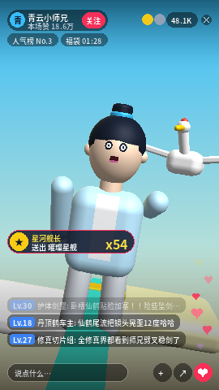
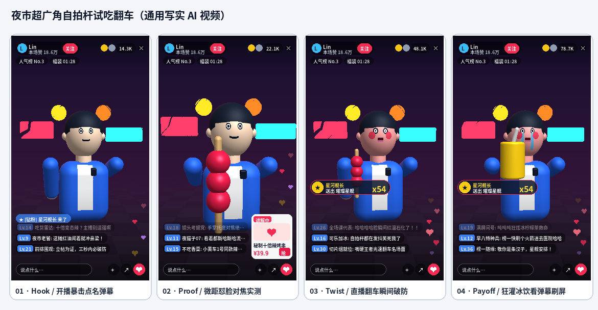
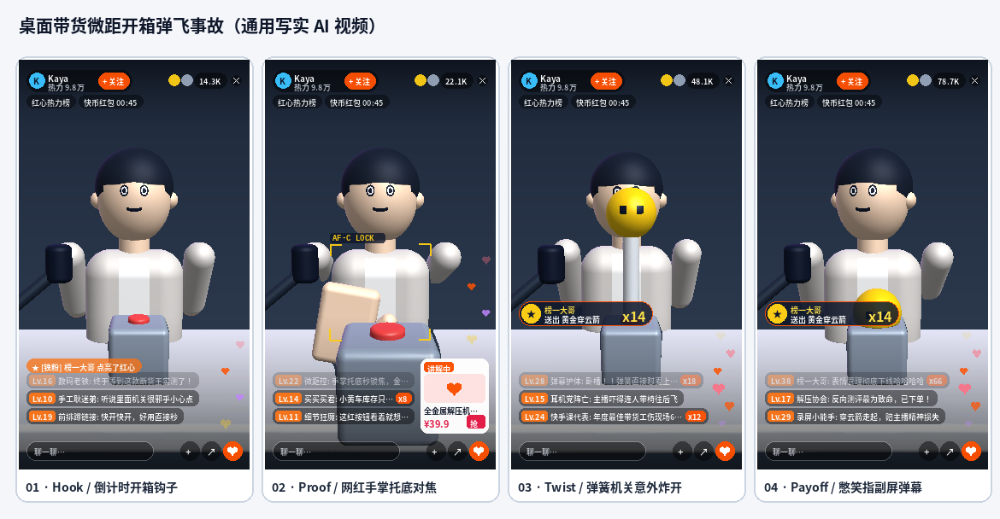
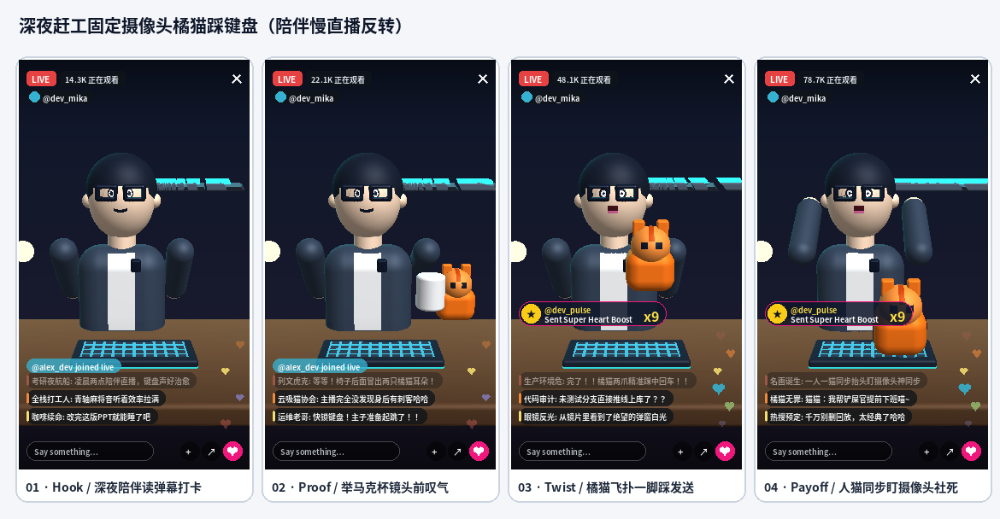
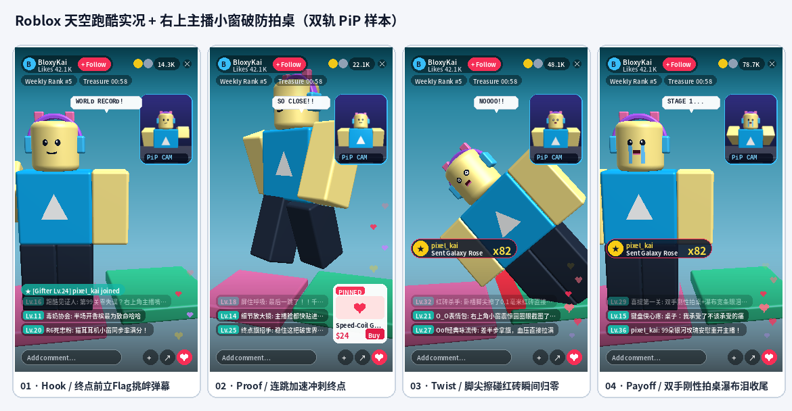
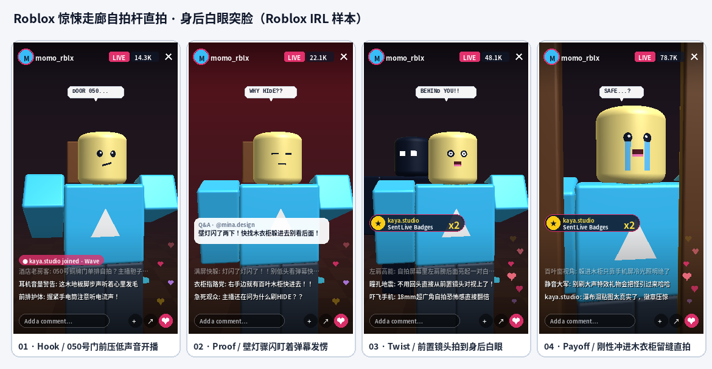
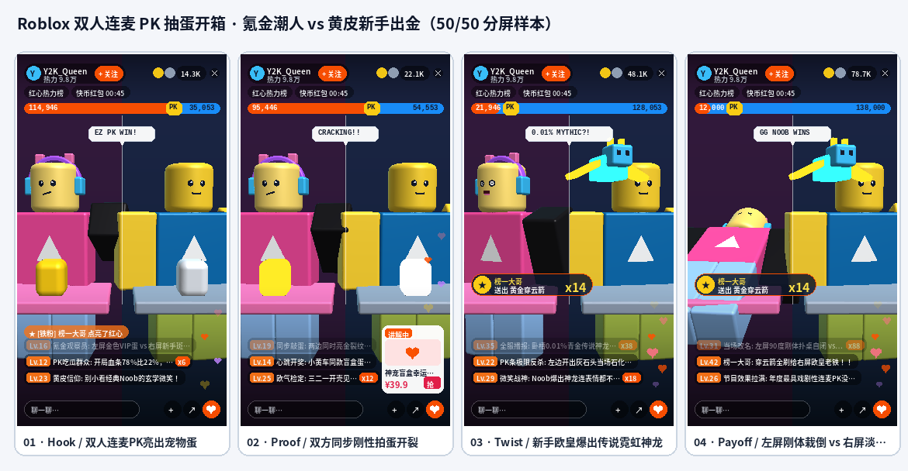
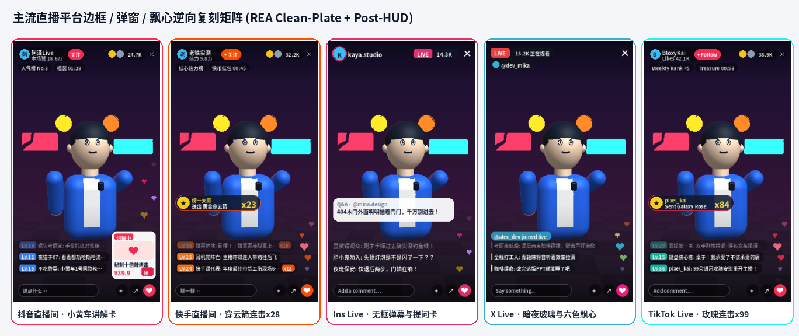
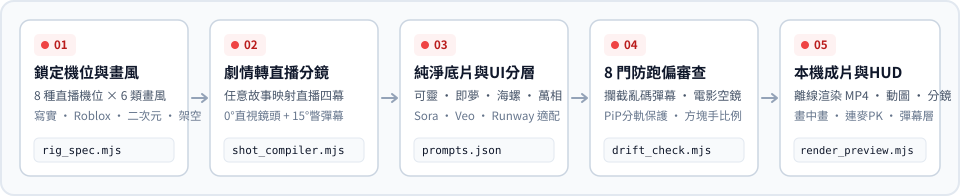
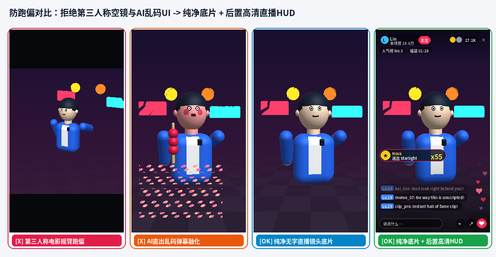

<div align="center">

# Livestream Style Video Skill

一套面向 Claude Code、Cursor、GitHub Copilot 與 Codex 的 **Agent Skill**（`SKILL.md` + 領域參考手冊 + 零依賴命令列腳本）：將任意畫風與劇情轉譯為 9:16 直式直播視角四鏡分鏡、逐鏡編譯無亂碼影片提示詞、復刻主流直播間邊框特效，並在本機離線預演動態成片。

[](../../SKILL.md)
[](#skill-工作流與安裝使用)
[](../../LICENSE)

**[短片範例](#短片範例)** · [分鏡與直播介面](#分鏡拆解與多平台直播表) · [Skill 工作流與安裝](#skill-工作流與安裝使用) · [Skill 指南](../../SKILL.md)

[English](../../README.md) · [简体中文](../../README.zh-CN.md) · **繁體中文** · [日本語](README.ja.md) · [한국어](README.ko.md) · [Español](README.es.md) · [Français](README.fr.md) · [Deutsch](README.de.md) · [Português](README.pt-BR.md) · [Русский](README.ru.md)

</div>

## 短片範例

作為可掛載的 Agent Skill，本專案可在對話中將任意題材與畫風拆解為 15 秒、4 鏡頭（`9:16` 直式）的完整直播視角短片包，內建 8 套模板（5 套通用寫實與跨題材 AI 影片樣本 + 3 套 Roblox 方塊直播樣本）。下方的 **MP4** 與動圖均由 `scripts/render_preview.mjs` 在本機離線渲染，用來在呼叫外部付費影片模型前，先確認物理機位、眼神互動軸、安全區與後置直播間 HUD 彈幕特效。

<p align="center">
  <a href="../../examples/irl-night-market-selfie/assets/irl_night_market_selfie.mp4"></a>
  <a href="../../examples/desk-unboxing-autofocus/assets/desk_unboxing_autofocus.mp4"></a>
  <a href="../../examples/midnight-corridor-fpv-live/assets/midnight_corridor_fpv_live.mp4"></a>
  <a href="../../examples/late-night-study-webcam/assets/late_night_study_webcam.mp4"></a>
  <br />
  <a href="../../examples/wuxia-sword-flight-live/assets/wuxia_sword_flight_live.mp4"></a>
  <a href="../../examples/roblox-obby-rage-pip/assets/roblox_obby_rage_pip.mp4"></a>
  <a href="../../examples/roblox-doors-irl-selfie/assets/roblox_doors_irl_selfie.mp4"></a>
  <a href="../../examples/roblox-pet-hatch-pk/assets/roblox_pet_hatch_pk.mp4"></a>
</p>

## 分鏡拆解與多平台直播表

影片生成模型若在單個 4 至 5 秒片段內串聯多步劇情或中途切機位，很容易退化成疏離的電影空鏡或肢體穿模。每支 15 秒直播短片固定拆為四個單動作節拍（`0–3.5s` 開播立 Flag、`3.5–7.5s` 懟臉對焦實證、`7.5–11.5s` 突發直播事故、`11.5–15s` 掃彈幕破防定格）：

| 鏡頭 01 · 開播鉤子 (`0–3.5s`) | 鏡頭 02 · 實拍自證 (`3.5–7.5s`) | 鏡頭 03 · 突發事故 (`7.5–11.5s`) | 鏡頭 04 · 破防收尾 (`11.5–15s`) |
| :---: | :---: | :---: | :---: |
|  |  |  |  |

六種直播機位與跨畫風題材的四格分鏡聯繫表：

| 01 · 夜市超廣角自拍 (`可靈` · `18mm` 手持雲台與抖音邊框) | 02 · 桌面微距開箱 (`即夢` · 手掌托底 `[AF-C]` 與快手邊框) |
| :---: | :---: |
| <a href="../../examples/irl-night-market-selfie/"></a> | <a href="../../examples/desk-unboxing-autofocus/"></a> |
| **04 · 深夜趕工橘貓踩鍵盤 (`萬相` · `24mm` 螢幕攝影機與 X 邊框)** | **06 · Roblox 天空跑酷畫中畫 (`海螺` · A/B 雙軌與 TikTok 邊框)** |
| <a href="../../examples/late-night-study-webcam/"></a> | <a href="../../examples/roblox-obby-rage-pip/"></a> |
| **07 · Roblox 走廊自拍桿 (`Sora` · 身後白眼突臉與 Ins 邊框)** | **08 · Roblox 雙人連麥 PK (`可靈` · 50/50 抽神龍反殺與快手邊框)** |
| <a href="../../examples/roblox-doors-irl-selfie/"></a> | <a href="../../examples/roblox-pet-hatch-pk/"></a> |

內建經 REA 協議與樣式逆向復刻的五大直播平台邊框、彈窗與飄心特效（`douyin`、`kuaishou`、`instagram`、`x`、`tiktok`，詳見[逆向台帳](../../references/platform-ui-rea-ledger.md)），亦可在 [`studio/index.html`](../../studio/index.html) 瀏覽器 / OBS 工作台中即時觸發或綠幕匯出：

<p align="center">
  
</p>

## Skill 工作流與安裝使用

<p align="center">
  
</p>

### 作為 Agent Skill 安裝呼叫

將本倉庫複製到宿主工具的 Skills 目錄後，AI 助手會自動按需讀取 [`SKILL.md`](../../SKILL.md) 與 [`references/`](../../references/) 參考手冊並呼叫本機腳本。下方路徑用於 Codex；GitHub Copilot 使用 `~/.copilot/skills/livestream-style-video`，Claude Code 與 Cursor 放入各自設定的 Skills 目錄即可。

```bash
git clone https://github.com/yuzhang-zhong/livestream-style-video.git ~/.codex/skills/livestream-style-video
```

在對話中直接呼叫 `livestream-style-video` Skill：

```text
使用 $livestream-style-video 把「中世紀騎士在巨龍洞口舉著水晶球自拍開箱聖劍，結果驚醒身後的紅龍」
規劃成一支 15 秒 9:16 直式直播短片，套用抖音直播間小黃車講解卡與禮物連擊邊框。
請給出直播機位與畫風鎖、4 鏡頭分鏡表和可靈 / Sora 純淨底片圖生影片提示詞。
```

### 直接執行 Skill 內建命令列腳本

所有輔助腳本可於倉庫根目錄獨立執行，僅依賴 Node.js 18+ 標準庫（無需 `npm install` 或 API Key）：

```bash
node scripts/render_preview.mjs --spec templates/custom_livestream_spec.json --out-dir out/ramen-live --platform douyin --force
node scripts/shot_compiler.mjs --plot "凌晨兩點拉麵攤主邊看彈幕謝禮物，身後豚骨湯突然撲鍋溢出來" --platform douyin --engine kling --lang zh-tw
node scripts/drift_check.mjs --pack templates/custom_livestream_spec.json --engine kling --lang zh-tw
```

## Skill 腳本、防跑偏檢查與參考文件

直接提示「直播間畫面、滾動彈幕文字」常會退化成第三人稱電影空鏡、焊死在畫面像素裡的亂碼 UI，或讓 Roblox 主播長出真人五指與樂高圓粒。本 Skill 將**純淨鏡頭底片**與**後置高清直播 HUD** 分層，`drift_check.mjs` 會在生成前攔截這 8 類跑偏項：

<p align="center">
  
</p>

| Skill 組件 | 輸出內容 |
| --- | --- |
| [`SKILL.md`](../../SKILL.md) | Agent Skill 主入口，定義 6 種工作模式與 8 項直播視角約束。 |
| [`shot_compiler.mjs`](../../scripts/shot_compiler.mjs) | 支援 `--plot` 任意劇情、`--spec` 或 8 套內建模板，編譯 15s / 30s / 45s 純淨底片提示詞與 HUD 時間軸。 |
| [`rig_spec.mjs`](../../scripts/rig_spec.mjs) | 鎖定 8 種物理機位 × 6 類正交畫風與[直播間三態參考卡](../../assets/showcase/rig_setup_sheet.zh.png)。 |
| [`hud_presets.mjs`](../../scripts/hud_presets.mjs) | 五大直播平台 `1080×1920` 安全區、彈幕樣式、雙槽禮物連擊、小黃車/問答彈窗與飄心色板。 |
| [`drift_check.mjs`](../../scripts/drift_check.mjs) | 8 門中英 Unicode 防跑偏審查器，攔截電影空鏡、亂碼彈幕、單軌 PiP 融化與 Roblox 五指串味。 |
| [`render_preview.mjs`](../../scripts/render_preview.mjs) | 本機 3D + 後置 HUD 影片直出引擎（含雙軌畫中畫、50/50 連麥 PK 與現場音效 MP4 / GIF）。 |
| [`studio/index.html`](../../studio/index.html) | 獨立瀏覽器 / OBS 互動式直播邊框工作台，支援本機 MP4 載入與 `#00FF00` 綠幕匯出（[介面預覽](../../assets/showcase/interactive_hud_studio.png)）。 |

[機位與光學](../../references/camera-rigs-and-optics.md) · [跨畫風矩陣](../../references/style-adapters-matrix.md) · [劇情轉直播節奏](../../references/plot-to-livestream-beats.md) · [五大平台介面逆向台帳](../../references/platform-ui-rea-ledger.md) · [各模型提示詞](../../references/model-prompt-playbook.md) · [防跑偏修復](../../references/rescue-and-anti-drift.md) · [8 套分鏡模板](../../references/viral-livestream-archetypes.md)

## 語言

Agent Skill 回覆與命令列 `--lang` 支援 `en`、`zh`、`zh-tw`、`ja`、`ko`、`es`、`fr`、`de`、`pt`、`ru`。

[English](../../README.md) · [简体中文](../../README.zh-CN.md) · **繁體中文** · [日本語](README.ja.md) · [한국어](README.ko.md) · [Español](README.es.md) · [Français](README.fr.md) · [Deutsch](README.de.md) · [Português](README.pt-BR.md) · [Русский](README.ru.md)

[MIT 授權條款](../../LICENSE)。獨立開源 Agent Skill 專案，內建潔淨室幾何重構直播介面，與字節跳動、快手、Meta、X Corp. 或 Roblox Corporation 無隸屬或背書關係。
