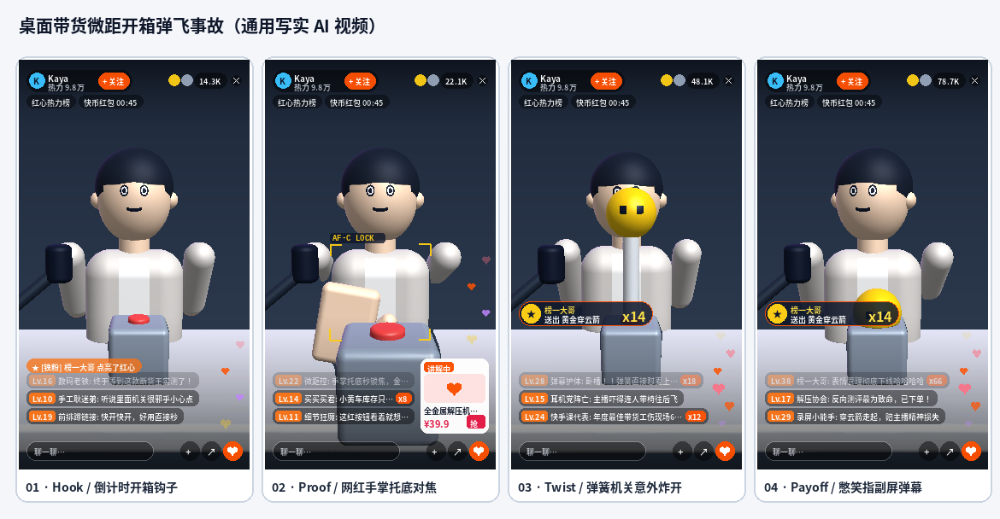

# 02 · Desk-Clamp Gadget Unboxing Spring Pop Fail (Realistic IRL) / 桌面带货微距开箱弹飞事故（通用写实 AI 视频）

15-second (`9:16`, 4-shot) **Livestream POV** package compiled with `--template desk-unboxing-autofocus --engine seedance --platform kuaishou`.

| 9:16 Animated Preview (Post-HUD) | 4-Shot Storyboard Contact Sheet |
| :---: | :---: |
| <a href="assets/desk_unboxing_autofocus.mp4"></a> |  |

## Package contents

- [`assets/desk_unboxing_autofocus.mp4`](assets/desk_unboxing_autofocus.mp4): offline 9:16 preview video (`H.264 MP4 + synthesized live audio + kuaishou HUD`)
- [`assets/storyboard_sheet.zh.png`](assets/storyboard_sheet.zh.png) · [`en`](assets/storyboard_sheet.en.png): Chinese and English 4-shot contact sheets
- [`rig_card.md`](rig_card.md): Camera Rig (`overhead-showcase-rig`) + Style (`realistic-irl`) DNA card and 3-state setup anchor prompt
- [`storyboard.md`](storyboard.md) · [`prompts.json`](prompts.json): Clean-Plate first-frame & `seedance` motion prompts + Post-HUD popup timeline
- [`drift_report.md`](drift_report.md): 8-gate anti-drift verification report (**PASS**)

## Reproduce

```bash
node scripts/rig_spec.mjs --rig overhead-showcase-rig --style realistic-irl --host "Kaya" --lang zh-en --out examples/desk-unboxing-autofocus/rig_card.md
node scripts/shot_compiler.mjs --template desk-unboxing-autofocus --duration 15 --engine seedance --platform kuaishou --lang zh-en --out examples/desk-unboxing-autofocus/storyboard.md
node scripts/shot_compiler.mjs --template desk-unboxing-autofocus --duration 15 --engine seedance --platform kuaishou --json --out examples/desk-unboxing-autofocus/prompts.json
node scripts/drift_check.mjs --pack examples/desk-unboxing-autofocus/prompts.json --engine seedance --lang zh-en --out examples/desk-unboxing-autofocus/drift_report.md
```
