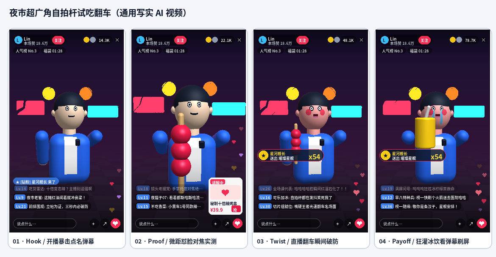

# 01 · Night-Market Ultra-Wide Selfie Skewer Fail (Realistic IRL) / 夜市超广角自拍杆试吃翻车（通用写实 AI 视频）

15-second (`9:16`, 4-shot) **Livestream POV** package compiled with `--template irl-night-market-selfie --engine kling --platform douyin`.

| 9:16 Animated Preview (Post-HUD) | 4-Shot Storyboard Contact Sheet |
| :---: | :---: |
| <a href="assets/irl_night_market_selfie.mp4"></a> |  |

## Package contents

- [`assets/irl_night_market_selfie.mp4`](assets/irl_night_market_selfie.mp4): offline 9:16 preview video (`H.264 MP4 + synthesized live audio + douyin HUD`)
- [`assets/storyboard_sheet.zh.png`](assets/storyboard_sheet.zh.png) · [`en`](assets/storyboard_sheet.en.png): Chinese and English 4-shot contact sheets
- [`rig_card.md`](rig_card.md): Camera Rig (`handheld-selfie-irl`) + Style (`realistic-irl`) DNA card and 3-state setup anchor prompt
- [`storyboard.md`](storyboard.md) · [`prompts.json`](prompts.json): Clean-Plate first-frame & `kling` motion prompts + Post-HUD popup timeline
- [`drift_report.md`](drift_report.md): 8-gate anti-drift verification report (**PASS**)

## Reproduce

```bash
node scripts/rig_spec.mjs --rig handheld-selfie-irl --style realistic-irl --host "Lin" --lang zh-en --out examples/irl-night-market-selfie/rig_card.md
node scripts/shot_compiler.mjs --template irl-night-market-selfie --duration 15 --engine kling --platform douyin --lang zh-en --out examples/irl-night-market-selfie/storyboard.md
node scripts/shot_compiler.mjs --template irl-night-market-selfie --duration 15 --engine kling --platform douyin --json --out examples/irl-night-market-selfie/prompts.json
node scripts/drift_check.mjs --pack examples/irl-night-market-selfie/prompts.json --engine kling --lang zh-en --out examples/irl-night-market-selfie/drift_report.md
```
