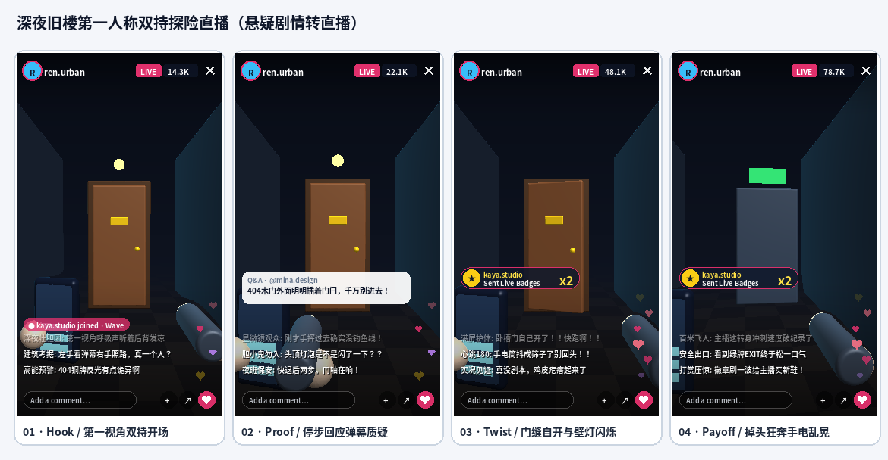

# 03 · Midnight Corridor First-Person Flashlight & Chat-Phone Live / 深夜旧楼第一人称双持探险直播（悬疑剧情转直播）

15-second (`9:16`, 4-shot) **Livestream POV** package compiled with `--template midnight-corridor-fpv-live --engine sora --platform instagram`.

| 9:16 Animated Preview (Post-HUD) | 4-Shot Storyboard Contact Sheet |
| :---: | :---: |
| <a href="assets/midnight_corridor_fpv_live.mp4"></a> |  |

## Package contents

- [`assets/midnight_corridor_fpv_live.mp4`](assets/midnight_corridor_fpv_live.mp4): offline 9:16 preview video (`H.264 MP4 + synthesized live audio + instagram HUD`)
- [`assets/storyboard_sheet.zh.png`](assets/storyboard_sheet.zh.png) · [`en`](assets/storyboard_sheet.en.png): Chinese and English 4-shot contact sheets
- [`rig_card.md`](rig_card.md): Camera Rig (`chest-head-pov`) + Style (`realistic-irl`) DNA card and 3-state setup anchor prompt
- [`storyboard.md`](storyboard.md) · [`prompts.json`](prompts.json): Clean-Plate first-frame & `sora` motion prompts + Post-HUD popup timeline
- [`drift_report.md`](drift_report.md): 8-gate anti-drift verification report (**PASS**)

## Reproduce

```bash
node scripts/rig_spec.mjs --rig chest-head-pov --style realistic-irl --host "ren.urban" --lang zh-en --out examples/midnight-corridor-fpv-live/rig_card.md
node scripts/shot_compiler.mjs --template midnight-corridor-fpv-live --duration 15 --engine sora --platform instagram --lang zh-en --out examples/midnight-corridor-fpv-live/storyboard.md
node scripts/shot_compiler.mjs --template midnight-corridor-fpv-live --duration 15 --engine sora --platform instagram --json --out examples/midnight-corridor-fpv-live/prompts.json
node scripts/drift_check.mjs --pack examples/midnight-corridor-fpv-live/prompts.json --engine sora --lang zh-en --out examples/midnight-corridor-fpv-live/drift_report.md
```
