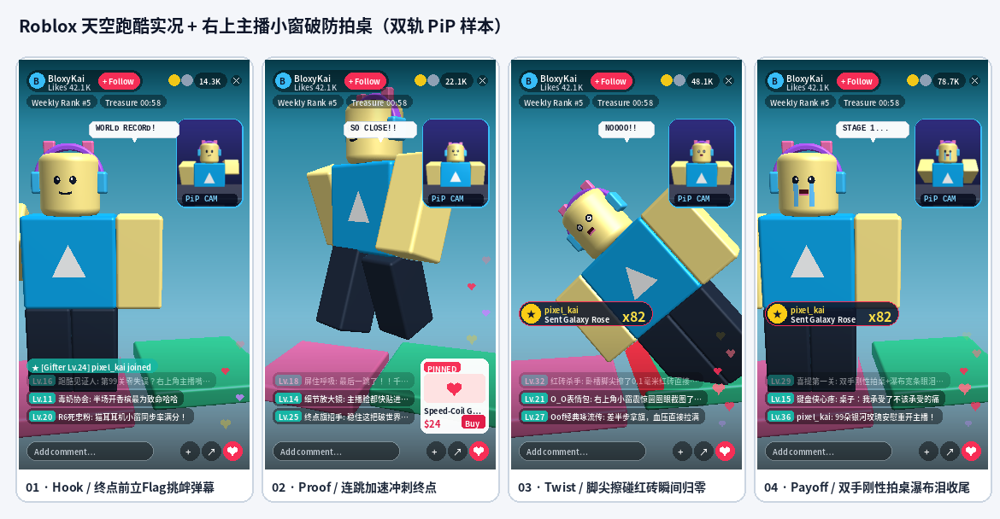

# 06 · Roblox Sky-Obby Speedrun + PiP Streamer Desk-Slam Rage / Roblox 天空跑酷实况 + 右上主播小窗破防拍桌（双轨 PiP 样本）

15-second (`9:16`, 4-shot) **Livestream POV** package compiled with `--template roblox-obby-rage-pip --engine hailuo --platform tiktok`.

| 9:16 Animated Preview (Post-HUD) | 4-Shot Storyboard Contact Sheet |
| :---: | :---: |
| <a href="assets/roblox_obby_rage_pip.mp4"></a> |  |

## Package contents

- [`assets/roblox_obby_rage_pip.mp4`](assets/roblox_obby_rage_pip.mp4): offline 9:16 preview video (`H.264 MP4 + synthesized live audio + tiktok HUD`)
- [`assets/storyboard_sheet.zh.png`](assets/storyboard_sheet.zh.png) · [`en`](assets/storyboard_sheet.en.png): Chinese and English 4-shot contact sheets
- [`rig_card.md`](rig_card.md): Camera Rig (`pip-facecam-rig`) + Style (`roblox-blocky`) DNA card and 3-state setup anchor prompt
- [`storyboard.md`](storyboard.md) · [`prompts.json`](prompts.json): Clean-Plate first-frame & `hailuo` motion prompts + Post-HUD popup timeline
- [`drift_report.md`](drift_report.md): 8-gate anti-drift verification report (**PASS**)

## Reproduce

```bash
node scripts/rig_spec.mjs --rig pip-facecam-rig --style roblox-blocky --host "BloxyKai" --lang zh-en --out examples/roblox-obby-rage-pip/rig_card.md
node scripts/shot_compiler.mjs --template roblox-obby-rage-pip --duration 15 --engine hailuo --platform tiktok --lang zh-en --out examples/roblox-obby-rage-pip/storyboard.md
node scripts/shot_compiler.mjs --template roblox-obby-rage-pip --duration 15 --engine hailuo --platform tiktok --json --out examples/roblox-obby-rage-pip/prompts.json
node scripts/drift_check.mjs --pack examples/roblox-obby-rage-pip/prompts.json --engine hailuo --lang zh-en --out examples/roblox-obby-rage-pip/drift_report.md
```
