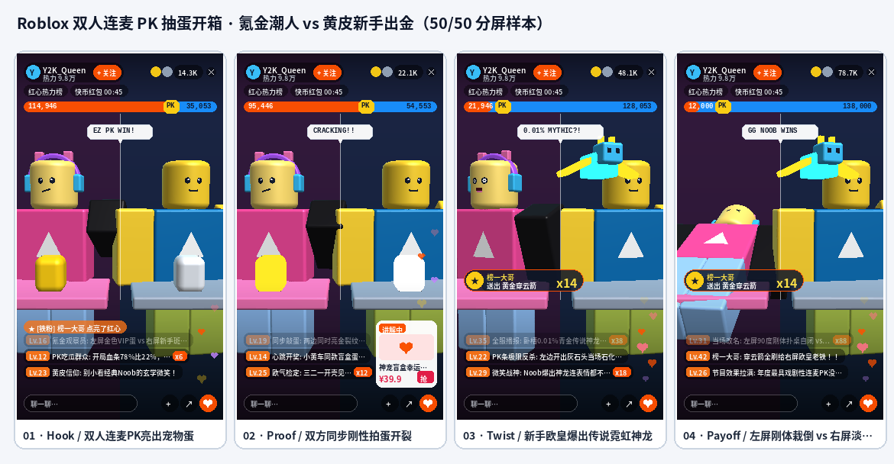

# 08 · Roblox Dual-Host PK Split-Screen Mystery Egg Hatch (Pro vs Noob) / Roblox 双人连麦 PK 抽蛋开箱 · 氪金潮人 vs 黄皮新手出金（50/50 分屏样本）

15-second (`9:16`, 4-shot) **Livestream POV** package compiled with `--template roblox-pet-hatch-pk --engine kling --platform kuaishou`.

| 9:16 Animated Preview (Post-HUD) | 4-Shot Storyboard Contact Sheet |
| :---: | :---: |
| <a href="assets/roblox_pet_hatch_pk.mp4"></a> |  |

## Package contents

- [`assets/roblox_pet_hatch_pk.mp4`](assets/roblox_pet_hatch_pk.mp4): offline 9:16 preview video (`H.264 MP4 + synthesized live audio + kuaishou HUD`)
- [`assets/storyboard_sheet.zh.png`](assets/storyboard_sheet.zh.png) · [`en`](assets/storyboard_sheet.en.png): Chinese and English 4-shot contact sheets
- [`rig_card.md`](rig_card.md): Camera Rig (`pk-cohost-split`) + Style (`roblox-blocky`) DNA card and 3-state setup anchor prompt
- [`storyboard.md`](storyboard.md) · [`prompts.json`](prompts.json): Clean-Plate first-frame & `kling` motion prompts + Post-HUD popup timeline
- [`drift_report.md`](drift_report.md): 8-gate anti-drift verification report (**PASS**)

## Reproduce

```bash
node scripts/rig_spec.mjs --rig pk-cohost-split --style roblox-blocky --host "Y2K_Queen" --lang zh-en --out examples/roblox-pet-hatch-pk/rig_card.md
node scripts/shot_compiler.mjs --template roblox-pet-hatch-pk --duration 15 --engine kling --platform kuaishou --lang zh-en --out examples/roblox-pet-hatch-pk/storyboard.md
node scripts/shot_compiler.mjs --template roblox-pet-hatch-pk --duration 15 --engine kling --platform kuaishou --json --out examples/roblox-pet-hatch-pk/prompts.json
node scripts/drift_check.mjs --pack examples/roblox-pet-hatch-pk/prompts.json --engine kling --lang zh-en --out examples/roblox-pet-hatch-pk/drift_report.md
```
